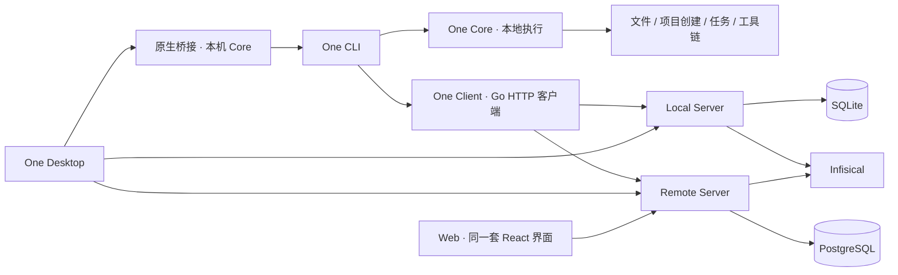

# One architecture / 架构边界

One has two independent capabilities: Core executes on the client machine; Server owns management data, configuration and provider integrations. CLI, Desktop and Web share `/api/v1`.

One 分为两部分：Core 在客户端本机执行操作；Server 管理数据、配置及外部服务集成。CLI、Desktop 和 Web 统一使用 `/api/v1`。

| Path / 路径 | Ownership / 职责 |
| --- | --- |
| `packages/cli` | Cobra commands, terminal interaction and local execution / 命令与本地执行入口 |
| `packages/one-core` | Local use cases, engineering models, templates, tasks and runtime ports / 本地用例、工程模型、模板与任务 |
| `packages/one-client` | HTTP API client, connection selection and server-backed environment loader / 统一客户端、服务选择与变量加载 |
| `services/server` | `one-api`, management use cases, Infisical, SQL persistence and Web hosting / 管理服务、集成、数据库及 Web 托管 |
| `apps/desktop` | Shared React management UI and trusted Tauri native host / 共用管理界面与原生宿主 |
| `apps/website` | Next.js static homepage / 静态官网 |

`go.work` contains four modules. The Server retains its former `services/desktop-api` Go module identity to preserve import compatibility; its filesystem location and project ID are `services/server` / `server`.

`go.work` 包含四个模块。Server 暂时保留原 `services/desktop-api` Go module 标识以兼容导入，目录与项目 ID 使用 `services/server` / `server`。

## Data ownership / 数据归属

- Engineering declarations (`one.manifest.toml`, `mise.toml`, source files) stay in Git. Clients register a workspace identity and project snapshot with the selected server. Servers do not read client paths.
- The database owns workspace/project indexes, environment bindings, preferences, global provider configuration, encrypted provider credentials and hashed browser sessions. Re-registering a checkout updates engineering metadata without overwriting managed bindings. Updates use revision checks. Forgetting a workspace hides its registry entry while retaining managed configuration; registering it again restores visibility.
- Client bootstrap keeps only server addresses, default/project selection and checkout paths in `connections.json`. Remote tokens use the OS keyring; browser sessions use HttpOnly cookies. The local runtime discovery file contains a private per-process token and generation, mode 0600. The preference cache is a startup hint, never the management source of truth.
- One Server is a single-owner service. Its administrator token authorizes the complete instance. It does not provide user/team isolation or remote task execution.

工程声明继续放在 Git；数据库保存项目索引、环境绑定、偏好及服务配置。客户端只保留连接、项目到服务的选择和本机目录映射；令牌进入系统钥匙串。SQLite 与 PostgreSQL 复用同一套业务及 HTTP handlers。当前是单用户管理实例，管理员令牌可访问整个实例。

## Execution and lifecycle / 执行与生命周期

CLI selects a server by `ONE_SERVER_URL`, then project binding, workspace binding, then default profile. A project can use a different server from its neighbors. The environment loader obtains a fresh snapshot for each invocation, then Core executes the subprocess locally and preserves its logs and exit status. It never uploads execution requests. Unconfigured local tasks need no service connection; configured data failures stop execution explicitly.

CLI 按环境变量覆盖、项目绑定、工作区绑定、默认服务选择连接。每次执行重新读取变量，随后在本机运行命令；配置服务不可用时明确失败。未配置管理数据的本地任务可独立运行。

`one` and `one-api` ship together. CLI or Desktop discovers/starts one independently supervised local server per `ONE_HOME`, protected by an interprocess lock. Before launch, its executable is copied to an immutable private data directory, so the running service does not lock a Desktop installation during updates. Desktop exit disconnects its client and leaves the shared server running. Immutable companion installations preserve helpers already running during CLI upgrades. Historical single-binary updaters are repaired lazily using a checksum-verified helper from the exact same release archive.

CLI 与 Desktop 共享每个 `ONE_HOME` 的一个本地服务。Desktop 退出只断开连接。终端安装与升级同时携带 `one-api`，运行中的旧服务程序保留，后续连接验证 API 版本。

## Compatibility and migration / 兼容与迁移

API version 1 is identical locally and remotely; existing `SERVE_*` error codes and `/api` aliases remain stable. Provider browser login is a local-server capability. Remote servers use Infisical machine identities, with encrypted credential storage and token refresh. Management export/import transfers metadata into an empty destination and excludes credentials, sessions, local paths and server identity.

本地服务首次启动备份并导入旧 preferences、工作区登记和全局绑定，保留原文件；旧默认安装的钥匙串会话加密导入数据库。备份位于 `data/import-backups`。远程迁移使用 `one server export/import`，目标服务独立授权，执行目录映射继续留在客户端。

See `services/server/README.md` for deployment and `AGENTS.md` / `RELEASING.md` for development and releases.
