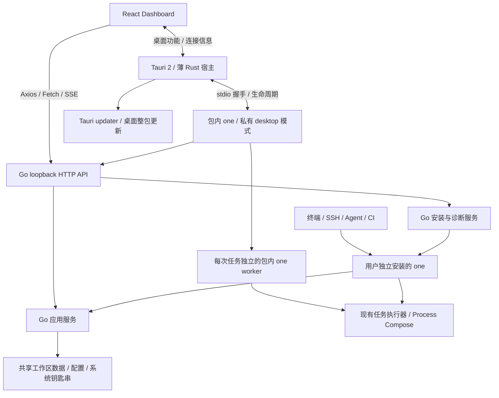
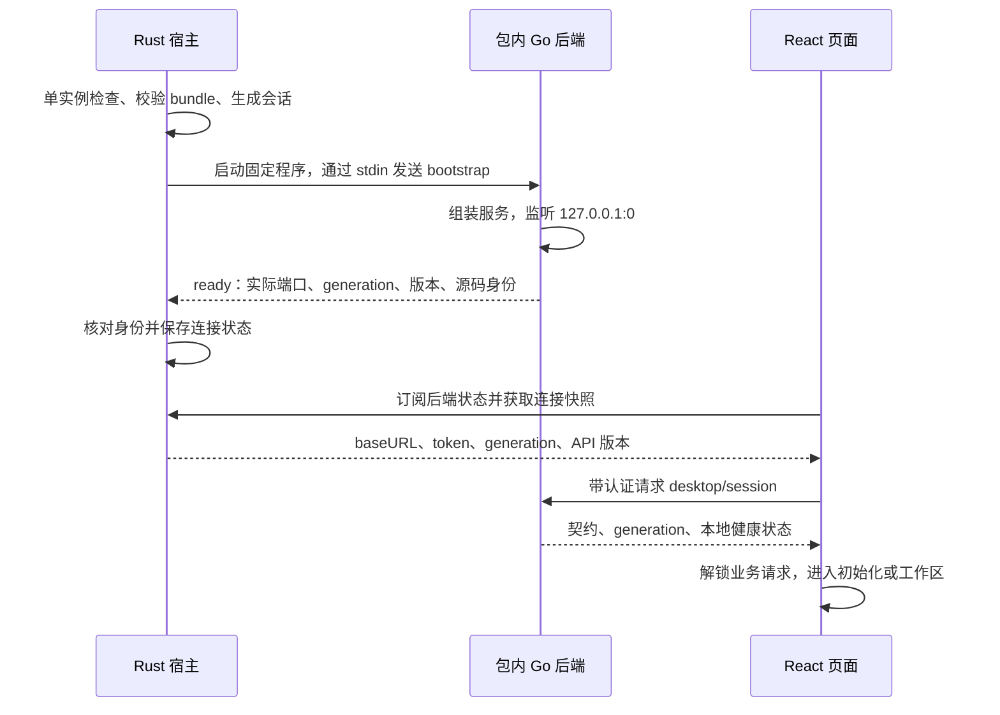
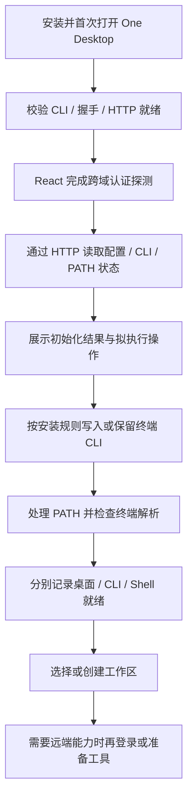

# One Desktop：Tauri 2 + React + Go CLI 完整方案

> 范围更新（2026-10-13）：桌面任务功能已移除，本文原先的任务 worker、任务 HTTP/SSE 接口及日志界面设计不再实施。任务统一通过终端 `one run` 执行，内置 `one` 保留为终端安装源。当前实现以 Desktop README 和实施计划为准。
> Scope update: Desktop task execution, task HTTP/SSE routes and the log viewer are removed. Use `one run` in the terminal; the bundled CLI remains the terminal installation source. The desktop README and implementation plan describe the current scope.

日期：2026-10-13（Asia/Shanghai）\
当前通信决策：React 通过浏览器原生 HTTP 直连内置 Go 后端；Rust 负责桌面能力、连接信息交付与后端进程管理。\
状态：架构与实施范围待评审；本次仅编写方案，没有修改业务代码、安装依赖、构建或发布。\
核查基线：`b0006701c8433b7081e08aaeaaa2eaca6e41181b`。\
本方案取代 [Wails 方案](2026-10-13-wails-desktop-design.md)，是后续实现的设计依据。文中标为“拟新增”的接口、目录、状态和流程尚未实现。

## 1. 已确定的方向

采用 **Tauri 2 + 现有 React Dashboard + 现有 Go CLI**。Tauri 提供桌面窗口、系统集成、进程管理和桌面更新；React 提供全部图形界面；Go 保留工作区、项目、变量、账号、模板、任务执行等业务能力。

Dashboard 页面从 CLI 的构建、内嵌资源和发行包中移除，改由 Tauri 随桌面分发。保留并改造现有 Go HTTP 后端：React 使用 Axios/fetch 直接访问包内 CLI 启动的 loopback API；业务请求和日志不经 Rust 转发。

Rust 负责窗口、系统集成、桌面更新、启动/监督/关闭 Go 进程，以及向可信前端交付本次连接信息。stdio 仅承载启动握手和少量生命周期消息，不建立通用业务 RPC。此决策取代本文件早期的全业务 stdio 方案。

独立 CLI 继续服务终端、SSH、Agent、自动化和 CI；不需要安装桌面，也不依赖桌面进程。两种产品共享业务实现、配置约定和发布源码，分别提供命令行入口和图形入口。独立 CLI 二进制可保留同一套私有后端能力，但普通命令不会启动 HTTP；公开的 `one serve` 浏览器入口按第 5.4 节迁移。

首版范围：

- 单实例、单窗口，窗口内管理多个工作区；沿用现有 React 页面与中英文切换。
- 工作区、项目、模板、配置、环境变量、账号及共享凭据管理。
- 桌面启动任务、查看状态与日志、停止本次任务及其所属子进程。
- 内置 CLI；首次启动完成检测、用户目录安装、PATH 配置与终端可用性检查。
- 桌面签名打包、版本检查、更新安装、重启检查、失败恢复，以及终端 CLI 的独立同步。
- 五种现有 CLI 目标平台继续保留；桌面平台逐项通过原生验证后开放。

首版不引入后台守护进程、开机自启、远程桌面代理、完整交互终端、多窗口或云端同步。已有 CLI/TUI 按原有方式使用。远程机器的浏览器 Dashboard 不再是本产品的交付入口。

## 2. 已核实的仓库现状

| 现状与证据 | 对设计的影响 |
| --- | --- |
| `apps/desktop/package.json` 使用 React 19、Vite 8、Tailwind v4、SWR、Zustand、React Router | 复用现有前端；无需迁移到 Flutter 或重写组件 |
| `apps/desktop/src/lib/http.ts` 使用 Axios 和 `/api`；`vite.config.ts` 代理会重写 Host/Origin | 复用 API 调用，增加运行时地址与认证；桌面开发直接请求 Go，不能用代理重写掩盖跨域问题 |
| `packages/one-core/internal/resources/bundled/bundled.go` 内嵌 `_web`、模板、registry 和技能 | 只移除 Dashboard 内嵌资源；模板、registry、技能继续保留 |
| `packages/cli/tools/sync-resources/main.go` 将 Dashboard dist 同步到 `_web` | 删除 `sync-web` 链路，保留 `sync-bundled` |
| 根 `mise.toml`、CLI `Taskfile.yml` 的构建、检查和开发流程与 `sync-web` 耦合 | 拆分 CLI 与桌面任务；独立 CLI 构建不应要求前端 dist 或 Rust |
| `internal/bootstrap/cli/dependencies.go` 已组装业务依赖；HTTP transport 调用 Go 服务 | 复用应用服务及 HTTP handlers，增加桌面后端 bootstrap，避免 Rust 复制业务 |
| `internal/transport/http/server.go` 支持 loopback 和动态端口；`middleware.go` 仅接受现有 SelfOrigin，缺少桌面 CORS 与会话 token 机制 | 保留 Host 校验，补齐精确 Origin 白名单、预检、所有业务 API 的认证及请求大小限制 |
| `internal/transport/cobra/serve/cmd.go` 会登记工作区并打开浏览器 | 为 `one serve` 制定明确迁移行为，并把目录登记移入桌面打开工作区流程 |
| `internal/modules/tasks` 使用 Process Compose、私有 loopback broker 和 `__process` worker | 保留任务执行器；桌面为每次执行建立独立 worker，不直接并发调用 Cobra 根命令 |
| `internal/platform/infisicalsession` 用系统浏览器登录、临时回调和系统钥匙串 | 复用 Go 登录；桌面本地 token 与账号凭据、OAuth 回调分别管理 |
| 工作区索引已有文件锁；偏好文件使用原子写入 | 继续审查跨进程读改写、字段保留和版本兼容，原子替换本身不足以避免覆盖 |
| Unix 安装脚本提示 PATH；Windows 脚本修改用户 PATH | 初始化要分别报告“CLI 已安装”和“终端已可用” |
| `one upgrade` 更新当前可执行文件的真实路径 | 必须识别桌面内置 CLI，阻止它改写桌面应用包 |
| 发布只接受五个 CLI 归档和 `checksums.txt`，GoReleaser 固定 2.18.0 | 扩展发布产物协议，同时兼容历史六附件版本及旧安装脚本 |

本节的 `internal/...` 均相对于 `packages/cli/`。本轮没有验证 Tauri 原生构建、各平台签名、安装或更新成功；相关内容属于下一阶段的验证事项。

## 3. 技术选型和代价

### 3.1 采用 Tauri 2

Tauri 官方支持把任意语言编译出的可执行文件作为 sidecar 随应用分发，适合保留现有 Go CLI。Rust 启动包内程序；React 通过 HTTP 调用 Go 业务，通过 Tauri IPC 调用桌面能力。[Sidecar 官方文档](https://v2.tauri.app/develop/sidecar/)

保留现有 React、Vite、Tailwind 及 Go module path。新增 Rust 工具链和 Tauri 2 的 JS/Rust 依赖；在技术验证通过后锁定精确版本、`Cargo.lock` 和前端 lockfile，不在方案阶段猜测最新补丁版本。[Vite 集成](https://v2.tauri.app/start/frontend/vite/)

初始插件范围限于 updater、dialog、opener、single-instance，以及 Rust 侧使用的 shell/sidecar 能力；需要重启时使用对应的原生进程能力。每项插件按实际窗口流程开放权限，不一并开启文件系统、shell 或任意 URL 能力。

业务 HTTP 使用 WebView 自带的 Axios/fetch，不使用 `@tauri-apps/plugin-http` 代为发起请求，也不新增 Rust 通用 HTTP 代理。官方 HTTP 插件属于另一条原生请求路径，不应与浏览器直连混为同一个架构；若平台验证出现无法解决的限制，需重新评审该选择。[Tauri HTTP 插件](https://v2.tauri.app/plugin/http-client/)

选型依据是官方 sidecar、桌面打包、签名更新和系统集成路径与本项目匹配。社区规模可以作为维护风险的参考，不能据此保证没有框架问题，也不需要重写成熟的 Go 业务以迁就桌面框架。

### 3.2 性能与复杂度

Tauri 采用 Rust 宿主和系统 WebView；它与 Wails 都会受到平台 WebView、前端渲染和原生依赖影响。不能预先承诺 Tauri 更快。本方案复用现有 HTTP 业务协议，新增成本主要是后端生命周期、跨域、会话认证和流式日志；省去逐接口 Rust 转发或重建完整 stdio RPC 的维护工作。[Tauri 进程模型](https://v2.tauri.app/concept/process-model/)

性能验证计入 Rust 宿主、WebView、Go sidecar 和任务进程的总开销，记录冷启动、空闲内存、项目切换、日志持续输出和任务启动延迟。协议序列化和日志渲染先测量，再优化。

### 3.3 原生支持范围

候选验证基线为 macOS 13.3+、Windows 10/11 x64 加受支持的 WebView2、Ubuntu 24.04 LTS 桌面与选定 WebKitGTK 版本。最终最低 OS 由 Rust/Tauri 依赖、WebView 和实际界面验证共同决定；这些候选值不是当前支持承诺。

Tailwind v4 的浏览器能力要求必须纳入测试，不能直接把 Tauri 最低 OS 当作产品最低 OS。Linux AppImage 也不意味着兼容任意 Linux 发行版。[Tailwind 浏览器要求](https://tailwindcss.com/docs/upgrade-guide#browser-requirements)、[Tauri 环境要求](https://v2.tauri.app/start/prerequisites/)、[AppImage 分发](https://v2.tauri.app/distribute/appimage/)

用户无需为了运行桌面应用安装 Go、Rust、Node 或 pnpm；开发任务所需工具继续通过 One 现有机制按需准备。内置 CLI 和本地初始化可离线完成，不等于登录、安装项目工具或下载模板依赖均可离线。

## 4. 总体架构与职责



图中的 Go 应用服务表示共享源码和数据契约，不表示桌面与终端共享同一个进程。每次工作区操作携带工作区 ID；Go 解析并校验真实目录，不采用可被多窗口或并发请求覆盖的全局“当前工作区”。

| 层 | 承担职责 | 边界 |
| --- | --- | --- |
| React | 页面、直接 HTTP 请求、流式日志、i18n；在内存保存本地连接信息 | 不直接读钥匙串、执行 shell 或拼接系统命令 |
| Rust 宿主 | 窗口、菜单、目录选择、sidecar 监督、连接信息交付、桌面更新 | 不转发业务 API/日志，不实现项目创建、变量合并、任务解析或账号业务 |
| Go 应用服务 | 现有业务、数据访问、登录、安装诊断、任务控制 | 独立于 HTTP、Tauri 和 React |
| Go HTTP transport | 现有 REST API、token 校验、CORS、错误、任务状态与 SSE | 所有业务访问在 Go 校验；只监听当前桌面会话的 loopback 地址 |
| 生命周期控制通道 | bootstrap、ready、状态、准备退出、退出与 EOF | 小型版本化消息集，不承载通用方法调用、业务参数或任务日志 |
| Cobra transport | 终端交互、帮助、TUI、退出码 | 无桌面依赖，继续适用于 SSH/CI |

### 4.1 三种运行角色

| 角色 | 文件位置及使用规则 | 更新所有者 |
| --- | --- | --- |
| One Desktop | 平台应用安装目录 | Tauri 桌面更新流程 |
| 桌面内置 `one-api` | 常驻 HTTP 后端；宿主按包内绝对路径调用 | 仅随桌面整包更新 |
| 桌面内置 `one` | 任务 worker 和终端安装源；使用包内绝对路径 | 仅随桌面整包更新 |
| 终端 `one` | 用户安装目录或用户自行管理的位置 | 现有安装/升级方式；桌面按版本及所有权规则同步 |

桌面不通过 PATH 搜索后端，也不因终端 CLI 升级而更换后端。独立 CLI 不依赖桌面安装路径。内置与独立 CLI 可以版本不同，只要共享数据格式满足兼容契约。

## 5. Dashboard 从 CLI 拆出的范围

### 5.1 目录和构建

按后续确认的结构，React 工程重命名为 `apps/desktop`，project ID 为 `desktop`，Rust 使用其中的 `src-tauri/`。HTTP 服务拆成 `services/desktop-api` 的 `one-api`，共享业务放入 `packages/one-core`，应用同时内置 `one-api` 和终端 CLI `one`。Core 采用 `pkg/` 共享能力与 `internal/` 私有实现的布局。

拟新增或调整的结构：

```text
apps/desktop/
  src/                         # React 页面、状态、i18n、HTTP/SSE
  src-tauri/                   # Rust 宿主、Tauri 配置、权限和图标
    binaries/                  # 生成的 one-api 和 one
services/desktop-api/
  cmd/one-api/                 # 独立 HTTP 后端入口
  internal/app/                # 宿主握手和生命周期
  internal/http/               # 业务路由及认证/CORS/SSE
  internal/runs/               # 桌面任务进程管理
packages/one-core/
  pkg/                         # application、bootstrap、core、modules、platform、ports
  internal/adapters/           # 私有运行时、厂商和存储实现
  internal/resources/bundled/  # 内嵌模板、registry、技能
packages/cli/
  cmd/one/                     # 命令行与包内任务 worker
  internal/transport/cobra/    # 终端输入输出
```

移除 `go:embed all:_web`、`WebDistFS`、`WebDistRoot`、`syncWeb` 和 `sync-web` 任务，清理相应生成文件、忽略规则及文档。模板、registry、技能继续嵌入 CLI；模板中的前端代码不属于待删除的 Dashboard 资源。

CLI 叶子构建、检查、帮助文档验证不再依赖 Dashboard dist 或 Rust。根级完整检查仍覆盖 React 与 Go，并增加适用于构建主机的 Rust/桌面检查；完整发布仍需 Node、pnpm 和原生工具链。重写当前 `cli:dev` 的 `one serve` 路径，桌面开发由 Tauri dev 启动 Vite 和指定开发 sidecar。

### 5.2 拆出网页，保留 API

将原 HTTP 层的业务 handlers 移入 `services/desktop-api/internal/http`，保留、请求/响应 DTO 和应用服务注入。移除 SPA fallback、静态资源、浏览器启动页，以及仅为公开 `one serve` 设计的服务启动逻辑；不把业务 handlers 搬进 Rust。

现有 `SelfOrigin` 是 Go 服务自己的 URL，不能作为 Tauri 页面的 Origin。保留并收紧 Host 校验，将 Origin 策略改为第 6 节的桌面来源白名单，并新增 token 认证与 CORS。不要简单删除校验或设置全来源通配符。

系统浏览器登录的临时回调、任务私有 broker 和用户项目自己的开发服务器继续保留各自边界，不与桌面 API 合并为同一认证机制。外部 provider 请求仍由 Go 执行。

交付完成条件：发行 CLI 不含 Dashboard 静态资源，React 页面由 Tauri 加载；业务 `/api` 由包内 CLI 提供并受本次桌面会话认证保护；普通 CLI 命令不启动服务。首版继续使用同一 Go 二进制提供终端入口与私有桌面后端，不增加一套独立编译的业务服务。

### 5.3 现有功能迁移矩阵

| 当前管理能力 | 桌面入口与 Go 落点 | 独立 CLI 要求 |
| --- | --- | --- |
| catalog、项目模板查询 | 模板页 → catalog/template 服务 | 保留模板查询与项目创建流程 |
| 工作区登记、列表、遗忘、概览 | 工作区选择器 → registry/workspace 服务 | 继续支持从目录执行命令；纯桌面“最近打开”无需强制增加 CLI 菜单 |
| 环境、项目信息、项目创建 | 现有页面 → manifest/creation 服务 | 保留现有 create/add 等入口及非交互方式 |
| manifest 预览/应用、环境绑定 | 配置页 → revision 校验及应用服务 | 保留文件配置方式，缺失的必要机器操作入口在迁移时补齐 |
| 工作区 secret 增删改查 | 变量页 → Go 环境与凭据服务 | 核对现有 env/exec 能力，补齐必要操作，不能要求打开桌面 |
| 会话状态、登录、取消、退出 | 账号页 → 独立 session attempt 服务 | login/whoami/logout 独立可用 |
| Infisical 项目列表、详情及创建 | 账号/绑定流程 → provider 应用服务 | 核对现有命令及直接配置路径，列出缺口后确定精简命令入口 |
| 全局凭据位置初始化、secret、folder | 共享凭据页 → 现有全局凭据服务 | 保留并验证现有全局凭据能力，不假设这些能力目前只能在网页操作 |
| 语言及其他偏好 | 设置页 → preferences 服务 | 沿用 locale、auto 和偏好解析逻辑 |
| 任务启动、停止、状态、日志 | 桌面任务控制器 → 独立 Go worker | 保持 run/exec/TUI 原有语义 |

矩阵不宣称当前所有 HTTP 功能都有一一对应的 CLI 命令。实现前输出“现有路由 → 应用服务 → 桌面调用 → CLI/文件入口”的实际清单，保留可复用路径与 DTO；必要能力存在缺口时先补齐，再移除旧浏览器入口。桌面使用按工作区 ID 定位的路由，不依赖原 `one serve` 启动目录；旧 singular workspace 路由仅在确认无调用后清理。纯 GUI 展示状态不需要机械地转为公开 CLI 命令。

“打开已有工作区”由 Rust 目录选择器返回路径，再由 React 通过拟新增的登记 HTTP 接口提交；Go 校验真实目录和 manifest 并返回 registry ID。不能把当前只有列表/遗忘等接口误当作已有完整的工作区打开流程。CLI 安装诊断与修复同样通过新增 HTTP handlers 调用 Go 服务，Rust 不承担这些业务实现。

### 5.4 `one serve` 兼容策略

首个迁移版本保留一个明确的迁移提示命令：返回非零退出码、说明 Dashboard 已迁至 One Desktop，并给出下载/迁移文档。它不启动 HTTP，不自动安装或打开桌面。中英文帮助、错误和发布说明同步修改；旧 JSON 成功结果不能继续伪造为可用服务地址。

保留 `serve` 命令名的占位，避免删除后意外落入同名任务快捷调用；用户项目名为 serve 的任务通过显式任务命令运行。后续是否移除占位另行评估。SSH/CI 用户得到明确说明，不被隐式引导到图形登录。

此项属于可见的兼容性变化。发布规划应显式评估 minor 升级；最终版本仍来自现有远端稳定 tag 规则，不在此方案中指定版本号或改变默认 patch 规则。

## 6. 前端直连 HTTP、认证与启动流程

本节的命令、连接字段、控制消息和新增路由均为拟定契约。实现时保留已有业务路径和 `one-cli/error/v1` 错误结构，不因桌面化重命名全部接口。

### 6.1 后端入口与三条通信路径

使用独立入口 `services/desktop-api/cmd/one-api`，通过 `one-core/pkg/bootstrap` 组装共享服务，复用 Go HTTP handlers。CLI 仅保留任务 worker 和终端安装的私有入口。它不打开浏览器、不提供网页、不读取系统 PATH 选择另一个后端；缺少宿主握手时超时退出。私有命令名本身不构成认证。

三条路径严格分工：

| 路径 | 内容 | 约束 |
| --- | --- | --- |
| React → Go HTTP | 所有业务查询/变更、安装诊断、任务操作、进度与日志 | Axios/fetch 直连，统一会话认证；Go 负责业务校验 |
| React ↔ Tauri IPC | 连接信息、后端状态、窗口、目录选择、更新和退出交互 | 仅可信应用窗口可调用，不提供通用业务转发 |
| Rust ↔ Go stdio | bootstrap、ready、生命周期状态、prepare-shutdown、resume、shutdown | 有限控制消息；无任意方法分发、任务日志或全套业务 DTO |

Rust 只理解启动、生命周期与连接元数据，业务 DTO 由 Go HTTP 定义与 TypeScript 类型保持一致。控制协议版本与 HTTP API 契约版本分别记录；破坏性变化提升主版本，兼容变化增加能力字段。React 校验 HTTP 契约，Rust 校验控制协议与包内版本/SHA，不生成三份完整的业务接口。

stdio 控制消息采用有最大帧长的 JSON Lines，stdout 只输出控制消息，stderr 输出经过过滤的诊断。Rust 持续读取两条管道，限制诊断缓冲，避免无人读取造成阻塞；不把 bootstrap 原文记日志。不在 Go 长驻进程中重复执行全局 Cobra 根命令。

### 6.2 从应用启动到页面可用



具体顺序与边界：

1. 第二个桌面实例只唤起现有实例；不会启动另一套后端。Rust 按已验证的包内路径启动 CLI，绝不搜索固定端口或复用不明的现有服务。
2. Rust 每次启动 Go 时生成独立 `generation` 与至少 256 bit 的加密随机 token。通过该子进程专有 stdin 交付 token、控制版本、当前环境允许的 Origin 和必要启动参数；不使用命令行参数、URL、普通文件或全局环境变量传递 token。
3. Go 只绑定 `127.0.0.1:0`，由系统分配端口，不采用“先找空端口再绑定”的两步方式。完成路由、认证和必要本地服务初始化后才发送 ready；没有成功绑定时不能报告 HTTP 就绪。
4. ready 包含 `generation`、实际端口、CLI 版本、源码 SHA、控制/API 版本与本地配置位置，不返回 token。Rust 对照自己启动的进程和 bundle manifest 核验，自己组装 loopback baseURL，不接受任意远程 URL。
5. React 先订阅后端状态，再取得连接快照；快照和事件带单调递增状态序号，避免订阅间隙或过期响应覆盖新状态。`get_backend_connection` 只对可信主窗口开放，凭据保存在内存，不通过全局事件广播。
6. React 创建本次 generation 的 HTTP client，调用拟新增 `GET /api/desktop/session`。这是带认证的本地探测，不是 Infisical 账号接口，也不会返回 token。确认实际跨域请求成功、版本兼容且必要存储可读后，才允许业务页面发请求。
7. 未登录属于正常状态，不阻止本地就绪。握手失败、超时、版本不符或配置损坏分别展示原因和恢复入口；不能把所有情况归为“网络错误”，也不能降级调用用户目录 CLI。

连接状态分为 `starting`、`httpReady`、`uiConnected`、`stopping`、`restarting`、`failed`。Rust 收到 ready 仅说明 Go 已就绪；React 的真实探测成功才说明 WebView 能连通。首次用户初始化另见第 9 节，不以复制 CLI 文件代替连接健康检查。

### 6.3 本地会话认证

每个实际业务请求发送 `Authorization: Bearer <session-token>`，并携带非秘密的 `X-One-Backend-Generation`。Go 对 token 使用恒定时间比较，同时核对当前 generation；包括只读查询、诊断、任务日志和安装接口在内，全部经过统一认证。唯一不要求 bearer 的 API 预检请求按第 6.4 节处理。

本地 token 只授权当前桌面后端会话，不是 Infisical 账号 token。它会进入可信 React 内存，因此 Go 是业务操作的主要校验边界：工作区 ID、路径、revision、任务参数、操作状态和凭据访问规则均在服务端验证。Tauri capabilities 约束原生 IPC，不会自动约束浏览器发往 Go 的 HTTP 请求。[Tauri capabilities](https://v2.tauri.app/security/capabilities/)

token 不存入 localStorage、IndexedDB、cookie、持久日志或 URL；HTTP client 只允许向当前可信 baseURL 的相对业务路径附加认证，URL 解析后必须仍属于预期 Origin 和 API 路径，拒绝外部绝对地址及 `//host` 等绕过形式。HTTP API 不返回重定向；本地 API 的所有响应不提供网页/脚本加载功能。请求日志过滤 Authorization、敏感字段和错误上下文，不记录 bootstrap 原文。

真实账号凭据、任务 broker token 和注入环境继续由 Go 持有。需要向用户显示具体 secret 时沿用现有显式查看流程；不能因本地 token 存在就把全部秘密放入首次状态响应。

Go 后端重启即更换 token 和 generation；旧 token 对新进程无效。Infisical 退出登录只改变账号状态，不混同为桌面连接失效；关闭后端时清除本地 token 并关闭监听。此机制隔离未授权网页和普通本地请求，不承诺抵御已能读取应用进程内存的同用户恶意程序。

### 6.4 Host、Origin 与 CORS

服务只绑定 IPv4 loopback，前端始终使用实际 `http://127.0.0.1:<port>/api`。Host 必须匹配实际监听地址与端口；不信任转发头，不放开局域网监听，不通过固定公共域名转接本地 API。

拟采用以下来源基线，最终值以锁定版本的实际安装包观测为准：

| 场景 | 预期页面 Origin | 处理 |
| --- | --- | --- |
| macOS/Linux 正式包 | `tauri://localhost` | 只允许当前平台确实使用的应用来源 |
| Windows 正式包，默认 HTTP scheme | `http://tauri.localhost` | 按固定应用配置精确允许 |
| Tauri dev | `http://127.0.0.1:5173` | 开发配置固定 host/port，Vite 使用 strictPort；端口变化应显式更新配置 |

允许列表由受信宿主配置经私有握手交付，不从 HTTP 请求或 React 参数中动态扩展。发行配置不接受开发服务器 Origin；不反射任意来源，不使用 `*`，不普遍允许 `Origin: null`。若实际平台报告不符合预期的 opaque/null origin，先定位 WebView 配置并完成验证，不能通过放开来源绕过问题。

请求处理顺序：

1. 先验证 Host、请求大小等基础边界；有 Origin 的请求，无论读写都必须匹配允许列表。缺少 Origin 的原生诊断请求仍必须持有 token 和 generation，不能沿用“没有 Origin 就允许业务访问”的逻辑。
2. 合法的 `OPTIONS` 预检验证 Origin、目标方法和请求头，直接返回 `204`；浏览器不会在预检中发送业务 bearer，因此不能先要求 token 才处理预检。预检不调用任何业务服务。[CORS 预检](https://developer.mozilla.org/en-US/docs/Web/HTTP/Guides/CORS#preflighted_requests)
3. `Access-Control-Allow-Origin` 返回匹配的精确来源，设置 `Vary: Origin`；按需允许 `GET/POST/PUT/DELETE/OPTIONS` 以及 `Authorization`、`Content-Type`、`X-One-Backend-Generation`、`X-One-Request-Id`，不任意反射 header。
4. 实际请求继续验证 token、generation 和业务规则；允许来源的 401/403/409/503 等响应也带对应 CORS 头，使前端能读取真实错误。非法来源不获准读取响应。
5. 不使用 cookie 认证，前端跨域请求不携带 cookie，`withCredentials` 保持关闭、fetch 使用 `credentials: 'omit'`，不启用 `Access-Control-Allow-Credentials`。需要读取的请求 ID 和 generation 响应头显式列入 expose headers。

CORS 用于约束浏览器跨域读写；会话 token 负责认证，两者不能互相替代。系统浏览器的 OAuth 回调仍在独立回调 listener 上按原有 state/来源规则处理，不纳入要求前端 bearer 的桌面 API 路径。

### 6.5 CSP、页面协议与开发方式

正式 WebView 只加载随包前端，限制远程导航与脚本；登录和文档链接通过系统浏览器打开，并校验 URL scheme。CSP 保留 Tauri IPC 所需来源，业务网络的 `connect-src` 仅增加 `http://127.0.0.1:*`，不开放任意 `http:`、`https:`、局域网地址或整个网络。[Tauri CSP](https://v2.tauri.app/security/csp/)

这里允许端口通配是为了配合随机端口，是明确的取舍：它只能限制主机，不能把连接权限缩小到本次端口。HTTP client 再固定实际 baseURL，Go 再做会话认证；不要宣称 CSP 已实现进程级认证。未来若采用官方支持且经过验证的运行时精确 CSP，可进一步收窄，首版不依赖未验证的注入技巧。

Windows 首版保持 `useHttpsScheme: false` 的默认页面协议，不任意切换为 HTTPS：官方文档提示 HTTPS 页面访问 HTTP endpoint 会受到混合内容限制，跨版本切换 scheme 还会改变前端存储位置。macOS/Linux 的自定义协议也要实测，CORS 通过并不代表 CSP、WebView 本地网络策略或平台限制都已通过。[页面协议配置](https://v2.tauri.app/reference/config/#usehttpsscheme)

三类 OS 都必须使用真实打包页面完成带 Authorization 的 GET/写请求、预检、流式读取和重启重连验证；禁止通过关闭 WebView 安全、全局允许混合内容或放开所有 Origin 获得“通过”。某个平台不通过时停止宣布该平台支持，重新评审明确的兼容路径，不暗中切换 Rust 代理。

Tauri dev 同样直连随机端口后端；移除当前 Vite `/api` 代理的 Host/Origin 重写。仅开发 CSP 开放指定 HMR WebSocket，正式包不继承。浏览器独立打开 Vite 页面只用于明确标识的 UI 预览，不把会话 token 写进 `VITE_*`、URL 或公开开发服务器来伪造桌面连接。

### 6.6 前端 HTTP 适配与错误行为

保留 `src/api/` 的业务方法、Axios、SWR、Zustand 和现有错误转换。在 `src/lib/desktop/` 管理连接快照与后端状态，在 `src/lib/http.ts` 增加运行时 baseURL、认证、generation、请求 ID 和请求取消；不为每个业务方法新增 Tauri command。初始化完成前暂停业务请求，页面不要依赖模块加载时即创建固定 `/api` client。

缓存键带工作区 ID、环境、必要 revision 与 backend generation。后端切换时取消旧请求和流，丢弃旧 generation 的迟到响应，重新获取服务器状态；用户未提交的表单保留并标记待核对，不能直接自动提交到新进程。

| 情况 | 前端行为 |
| --- | --- |
| 后端会话认证失败 | 查询宿主连接快照；只在 generation 已更新时重建 client，不提示用户重新登录 Infisical |
| 账号未登录或 provider 认证失败 | 按 Go 的具体错误码进入账号流程；不重启后端 |
| CORS/CSP/网络错误 | 结合宿主状态判断“Go 已运行但 WebView 连接失败”；普通 fetch 错误未必能精确区分原因，诊断保留这一限制 |
| revision 冲突 | 展示冲突并重新读取；不覆盖用户或终端的较新修改 |
| 后端准备退出，返回服务暂不可用 | 禁用新的写操作和任务，保留页面状态；不循环重试写请求 |

普通请求保留有界超时；耗时创建/安装/任务操作按需要返回 operation/run ID，再查询状态或订阅进度，不无限延长所有 Axios 请求。业务取消使用明确接口；关闭 HTTP 请求或页面并不自动等同于取消已经开始的操作。

读请求可在同一可用会话中有限重试。任务启动、创建项目、写 secret、安装 CLI 等操作使用请求/操作 ID 去重；去重范围和记录期限需明确。后端重启或响应丢失时可能已经产生实际结果，先检查持久记录及目标状态，不自动重放写请求，也不承诺跨远端服务的 exactly-once。

本地资源路由建议改为 HashRouter，避免页面刷新依赖原 Go SPA fallback。外部 provider 请求仍由 Go 完成；React 的本地 HTTP client 不能作为通用互联网请求器。

### 6.7 后端退出与恢复

Rust 监督真实子进程退出和控制管道；只在确认后端退出且旧会话所属进程已清理后，进行最多三次有上限的退避重启。单次 HTTP 超时、CORS 错误或账号登录失败不触发重启。无法确认旧 worker 状态时进入恢复界面，不自动启动重复任务。

每次重启产生新端口、token、generation，React 必须重新取得连接并实际探测；端口恰好复用也不能复用旧会话。Rust 状态通知只包含状态、generation 和非秘密错误；token 通过受限快照接口获取。达到重启上限后显示诊断与手动重试，避免无限循环。

窗口刷新仅重新连接仍健康的后端，不必重启 Go；订阅中断也不停止后台任务。更新或退出时，Rust 通过控制通道要求 Go 进入 quiescing 状态，Go 原子地停止接收新的写操作和任务并返回忙闲状态。用户取消退出则发送 resume；确认退出才让 Go 结束自己拥有的运行、刷新配置、关闭 HTTP 和控制通道。涉及单个任务的查看/取消仍由 React 直接调用 HTTP。

若 React 无响应，Rust 可根据生命周期状态显示原生退出提示，不能依赖前端完成所有清理。宿主控制管道 EOF 触发 Go 清理所属操作并退出；这些句柄不能被无关子进程继承而无限延长后端寿命。

## 7. 任务执行、进程与日志

### 7.1 worker 与生命周期

一个长驻 sidecar 负责管理操作；每次任务运行再启动一个包内 `one` 的私有 worker。worker 使用现有 Process Compose 和任务解析能力，隔离全局信号、TTY、输出和运行上下文。原有 `__process` 叶子进程继续来自同一套 CLI；为这些入口明确传入包内绝对路径。

`runId` 是桌面管理单次执行的单位。开始前校验工作区、环境、revision 和任务参数；重复点击不得意外启动两次同一请求。已由用户明确执行的任意项目命令仍交给现有任务引擎，Rust 不另造一套命令模板或环境解析规则。

生命周期规则：

1. 最小化窗口时任务继续。关闭应用且存在任务时，提供“停止任务并退出”或“取消退出”；首版不承诺退到后台持续运行。
2. 停止某次执行先发送取消，再等待优雅退出，超时后清理该运行拥有的进程树。Unix 验证进程组策略，Windows 验证 Job Object 或等价机制；不能假设插件的单进程 kill 会清理所有子孙进程。
3. Rust、Go 通过管道 EOF 和会话所有权处理宿主退出；崩溃恢复记录不以裸 PID 为依据盲目杀进程，需核对会话、启动时间与可验证身份。
4. 不接管也不结束用户从独立终端启动的任务。系统重启、强制终止等情况下不伪称所有用户程序都能优雅退出。

### 7.2 HTTP 操作与带认证的流式日志

拟新增以下任务接口，均位于统一认证和 CORS 中间件之后；最终路由命名与实际现有契约统一确认：

| 接口 | 用途 |
| --- | --- |
| `POST /api/task-runs` | 校验工作区、任务、环境和请求 ID，返回 `202` 及 run ID |
| `GET /api/task-runs/{runId}` | 查询状态、退出结果与日志读取位置 |
| `GET /api/task-runs/{runId}/events?after=<seq>` | SSE 事件流，按序号继续读取；URL 不含 token |
| `POST /api/task-runs/{runId}/cancel` | 显式取消本次执行，语义需幂等 |

React 使用带 Authorization 的浏览器原生 `fetch` 读取 `text/event-stream`，通过 AbortController 管理订阅。原生 EventSource 构造器不提供自定义 Authorization header 参数，因此首版采用 fetch 流，不把 token 填到 query string，也不为了 EventSource 引入 cookie 认证。[EventSource 接口](https://developer.mozilla.org/en-US/docs/Web/API/EventSource/EventSource)

SSE 封装 `generation`、`runId`、`seq`、事件类型及载荷；任务原始字节按可还原的编码封装，保留 stdout/stderr 通道和 ANSI。流解析正确处理分块边界、UTF-8、单帧大小和异常帧，不能假定一次网络 read 就是一条事件。日志始终走 Go → React，Rust 不转发或解析日志。

流连接采用心跳和空闲超时，不沿用 Axios 的普通请求总超时；Go 的 header/body/写超时按普通请求与长连接分别配置。订阅中断后仅在同一 generation 内按最后序号有界重连，去重已收到事件；缓冲已过期时明确返回缺失范围或历史读取入口，不静默从最新位置续接。跨 generation 先查询运行状态，不自动恢复或重启任务。

同一运行的事件有序，多个运行分别维护序号。限制订阅数、队列和磁盘占用，合并短日志批量刷新，保证缓慢前端不会无限占用内存或长期阻塞任务。UI 取消订阅只关闭流；停止任务必须调用 cancel 接口。

日志采用有界内存缓冲与批量 UI 更新，长日志写入有大小和保留期限限制的本地运行日志。溢出或丢弃区段必须明确显示，不静默丢日志；UI 使用虚拟列表。子进程原始内容保持原语言、颜色和控制台含义，终端控制序列由安全展示组件处理，不能变成 WebView 的脚本或系统动作。

首版支持非交互任务和实时输出；需要 TTY/交互输入的任务明确提示在终端运行。完整 PTY 终端需要额外协议和平台验证，单列后续范围。任务 broker token、注入环境和凭据不作为调试载荷发送给 React。

## 8. 共享数据、登录与兼容

### 8.1 一份业务数据

沿用现有工作区目录、manifest、环境配置、工作区 registry、语言偏好和 Infisical 会话存储。Go 继续读写系统钥匙串，不在 Rust Stronghold 或前端 storage 中再存一份账号 token。秘密只有在用户执行相应查看操作且业务允许时才返回，普通列表、日志、握手和错误不携带秘密值。

把当前 HTTP 登录 attempt 的状态管理抽到应用服务，供桌面和 CLI 复用：开始、等待浏览器、完成、取消、超时、重试。浏览器登录所需的临时 loopback 回调继续保留并校验；桌面退出后停止自身登录操作。

### 8.2 并发和旧版本

共享文件采用跨进程锁、读改写、原子提交，并保留不能由当前版本解释的字段。manifest 修改使用 revision 检查，冲突时让用户重新载入差异，不能后写覆盖先写。迁移前保留可恢复副本；首版避免不可逆的数据格式变更。

桌面窗口位置、更新记录、日志索引和 sidecar 状态放在独立的桌面数据命名空间，避免旧 CLI 重写偏好时删除桌面字段。涉及共享 schema 的升级必须声明支持的读写版本；不兼容时禁止写入并给出升级/恢复路径。高版本终端 CLI与旧桌面并存需要纳入验收。

### 8.3 GUI 环境差异

从 Dock、Finder 或 Windows 开始菜单启动时，不能假设继承交互 shell 的 PATH、XDG 或代理配置。设置页展示当前配置与安装路径；允许明确选择与终端一致的目录，发现不同目录时提示合并选择，不静默新建第二套业务状态。

任务工具发现继续采用 Go 现有 resolver，并补齐 GUI 启动环境下的验证。不要通过无条件执行 shell 启动文件导入整个环境；环境诊断限定必要字段，避免把凭据输出到界面或日志。

## 9. 内置 CLI、首次初始化与脚本安装一致性

### 9.1 安装服务是共同规则来源

拟新增 Go installation 服务，统一安装路径、版本比较、锁、校验、文件替换、PATH 处理和安装结果。React 通过已认证 HTTP 接口调用该服务；安装脚本负责识别平台、下载和校验发行 CLI，再交给程序执行安装阶段。旧版本安装保持兼容 fallback，不能让新脚本依赖旧 CLI 尚不存在的命令。

“一致”指下载来源不同但安装语义和结果一致：脚本使用所选发布版本，桌面使用随包版本；均产生可独立使用的用户目录 CLI。桌面首次启动不再下载 latest，也不执行一段远端脚本。

| 平台 | 默认独立 CLI 目标 | PATH 行为 |
| --- | --- | --- |
| macOS/Linux | `~/.local/bin/one` | 延续脚本现状：未在 PATH 时给出准确指引；桌面可在初始化中应用展示过的 shell 配置修改 |
| Windows | `%LOCALAPPDATA%\Programs\one\bin\one.exe` | 按现有方式维护用户 PATH，保留原值语义并去重 |

保留安装脚本的自定义目录约定（含 `ONE_INSTALL_DIR`）；桌面使用明确选择的目标路径，不假设 GUI 一定继承该环境变量。不需要管理员权限作为默认前提。

### 9.2 首次启动流程



首次启动界面默认提供“完成初始化”，说明独立 CLI 的安装目录和已有版本处理结果；遇到自定义安装冲突再让用户选择。可暂时跳过终端集成并使用桌面，但应显示“终端命令尚未配置”，不能把这种状态标成完整初始化成功。

安装或 PATH 操作耗时较长时，Go 返回操作 ID，由 React 读取进度；丢失响应后先查询事务记录再允许重试。窗口重载、后端重启或更新不能触发重复安装。Rust 的职责是维持后端可用及原生交互，不直接执行安装脚本或复制用户 CLI。

初始化不自动登录、不创建远端项目、不扫描或迁移全部用户目录、不预装所有项目工具。已有业务配置就地复用，已登记工作区可直接选择。

### 9.3 已有 CLI 的处理

| 检测结果 | 默认行为 |
| --- | --- |
| 未安装 | 从包内复制到用户目录，验证后登记 |
| 已有较旧的普通用户目录安装 | 显示将升级至内置版本，通过同一安装事务更新 |
| 相同版本且文件身份/健康状态符合记录 | 保留文件，继续检查 PATH；版本字符串相同不代表无需检查 |
| 已有更高正式版本 | 保留高版本，不自动降级；桌面仍使用自己的 sidecar |
| 开发版本、符号链接、包管理器安装、未知来源或不同自定义目录 | 不自动覆盖；提供保留现状或明确安装到所选目录的选项 |
| PATH 中存在更靠前的 `one`、alias 或 function | 指出实际遮蔽来源；仅复制新文件不算 shell 已就绪 |

版本比较不能把开发字符串当作正式 semver 强行排序。版本、真实路径、文件身份和安装来源分开判断。相同版本不同字节也可能来自平台签名，不直接判成损坏。

### 9.4 安装事务与 PATH

安装按目标真实路径加跨进程锁，与 CLI 升级和桌面同步互斥。先写同目录临时文件、验证摘要和可执行性，再保留旧文件并原子替换；Windows 的占用文件处理沿用经过验证的 worker 方式。验证失败恢复旧文件，不留下半个可执行程序。恢复时必须确认目标仍是本事务写入的文件，不能覆盖用户随后做出的修改。

PATH 变更与二进制安装分别记录、可重试，失败只撤销本次拥有的修改。Unix shell 配置按实际 shell 和启动模式处理：zsh 考虑 `ZDOTDIR`，bash 区分 login/interactive；对尚未验证的 shell 提供准确手动指引。不要每次启动追加一行，也不要依赖应用运行时临时 export 伪装永久生效。

Windows 更新用户 PATH 时保留变量引用、原注册表值类型及已有条目，不将展开后的值覆盖原值；广播环境变更，并提示开启新终端。验证通过后分别记录：

- `desktopReady`：内置 CLI 身份和控制握手正确，React 已完成真实 HTTP/CORS/认证探测，业务存储和界面就绪。
- `cliInstalled`：独立目标文件已校验，能启动且版本符合规则。
- `shellReady`：新终端会话实际解析到预期 CLI，或用户选择保留的更高版本。

新 shell 验证要有超时，失败展示可执行诊断；不要输出完整环境。对于无法可靠检查的自定义 shell，状态为待确认并提供命令，不能报告假成功。

### 9.5 内置版本保护与卸载

内置 `one upgrade` 和自动更新入口识别打包布局、真实路径和 bundle manifest，转交桌面更新提示，不允许直接改写应用包。保护覆盖所有升级入口及更新 worker；隐藏 flag 或单个环境变量不是充分的身份判断。复制到用户目录后的 CLI 按正常独立版本工作。

Linux AppImage 中的 sidecar 位于临时挂载目录；初始化复制实际字节到用户目录，不能建立指向 `.mount` 路径的持久链接。Windows/macOS 同样不把终端 CLI 软链接到可被桌面更新替换的目录。

卸载桌面默认保留独立 CLI、工作区、业务配置与钥匙串会话；用户仍可在终端工作。单独清理入口只移除能确认归本安装管理的文件，不删除用户项目。

## 10. 打包与发布

### 10.1 两类产物，同一发布版本

对外提供独立 CLI 归档和 One Desktop 安装包。桌面包含 React 静态资源、Rust 宿主、对应平台 Go sidecar、必要资源/许可证及 bundle manifest；独立 CLI 不含 Dashboard。三者版本及源码 SHA 来自同一个固定发布提交。

GoReleaser 2.18.0 继续负责五个 CLI 目标，保留 `CGO_ENABLED=0`、现有构建注入和归档规则。Tauri 使用其原生构建打包工具；不为了统一命令把桌面塞入现有 Go 交叉编译步骤。

| Go 目标 | Tauri sidecar 输入文件后缀（候选目标） | Updater 平台键 |
| --- | --- | --- |
| darwin/amd64 | `x86_64-apple-darwin` | `darwin-x86_64` |
| darwin/arm64 | `aarch64-apple-darwin` | `darwin-aarch64` |
| windows/amd64 | `x86_64-pc-windows-msvc` | `windows-x86_64` |
| linux/amd64 | `x86_64-unknown-linux-gnu` | `linux-x86_64` |
| linux/arm64 | `aarch64-unknown-linux-gnu` | `linux-aarch64` |

`bundle.externalBin` 配置逻辑名称，构建输入按目标添加 `-$TARGET_TRIPLE`，Windows 再加 `.exe`；运行时通过 sidecar 逻辑名称定位实际包内文件。Go arch、Rust target triple、updater 平台键是三个映射，不能混用或只按构建主机推断。[Sidecar 打包规则](https://v2.tauri.app/develop/sidecar/)

五个平台是目标矩阵，不代表桌面五平台必须同时首发。首个正式发布前固定已验证桌面集合；未通过的目标不生成假安装包或更新条目，独立 CLI 五归档仍全部保留。

### 10.2 平台安装与更新包

| 平台 | 首版安装分发 | 官方 updater 使用的产物 | 必要验证 |
| --- | --- | --- | --- |
| macOS Intel/Apple Silicon | 分架构 DMG，内含 `.app` | `.app.tar.gz` 及 `.sig` | 宿主与 sidecar 签名、notarization、Gatekeeper、从 Applications 启动 |
| Windows x64 | NSIS 用户级安装器 | 对应 setup `.exe` 及 `.sig` | Authenticode、WebView2 准备、路径含中文/空格、运行中文件占用 |
| Linux amd64/arm64 | AppImage | AppImage 及 `.sig` | 选定发行版兼容、可执行权限、挂载运行、持久安装路径和替换 |

首版 Windows 只选择 NSIS，避免同时维护 MSI 与 NSIS 更新路径。Linux 首次集成将 AppImage 放到用户明确选择的持久目录；不可写目录或临时运行位置先引导完成安装，不直接承诺可原地更新。[Windows 安装器](https://v2.tauri.app/distribute/windows-installer/)、[macOS 应用包](https://v2.tauri.app/distribute/macos-application-bundle/)、[Updater 产物](https://v2.tauri.app/plugin/updater/)

macOS、Windows、Linux 分别使用符合目标要求的原生构建环境；Linux arm64 也必须验证其实际构建与运行路径。最终用户不需要编译工具链。包体、冷启动和内存以签名后的真实发行产物测量。

### 10.3 内置 CLI 来源与签名

构建一次规定来源的 Go payload，再送入各平台桌面打包；不允许桌面流水线悄悄下载 latest 或另取不同提交。bundle manifest 至少记录产品版本、源码 SHA、目标、控制/API 契约版本、正式页面协议/Origin 配置身份、CLI 构建身份、签名前来源摘要与最终 sidecar 摘要。随机端口和会话 token 不写入发布产物。

macOS/Windows 签名可能改变可执行文件字节，因此“同版本同提交”不必然表示桌面 sidecar 与公共 CLI 归档内程序的 SHA256 完全相同。可以统一在分流前签名，也可以分别记录签名前后关系；所有差异必须可追溯到允许的签名步骤。复制至用户目录后按实际 payload 摘要验证。

区分平台代码签名、Tauri 更新签名和文件 SHA256。它们分别解决系统信任、更新包真实性和字节一致性问题，不能相互替代。签名私钥通过受控凭据注入，不提交仓库、不打印或写入普通构建记录。

### 10.4 延续 `mise run release`

唯一发布入口仍为 `mise run release`；现有 [RELEASING.md](../../RELEASING.md) 的规则继续生效。新增原生构建收集阶段，控制端固定同一 tag/SHA，各平台只产出可验证文件与构建记录，不独立发布或抢设 Latest。

完整顺序：

1. 从远端最高稳定 tag 规划版本，核对已提交 master；建立独立干净源码副本和版本化产物清单。
2. 按清单锁定 CLI 五目标、已支持桌面目标、工具链、协议、签名身份及源码 SHA。
3. 执行完整检查，构建 CLI；各原生环境构建、签名桌面及 updater 产物。收集结果必须逐项匹配同一发布计划。
4. 本地检查每个安装包和更新包、签名、sidecar 身份、版本及功能冒烟；核对所有摘要和中英文说明。
5. 通过后才推送固定 tag、创建/复用草稿、上传全部预期附件；下载草稿附件重新校验。
6. 验证 updater feed 的平台映射、版本、URL 和签名内容，再公开并设为 Latest；随后在隔离目录检查真实下载和升级入口。

保留五个现有名字：`one-cli_darwin_amd64.tar.gz`、`one-cli_darwin_arm64.tar.gz`、`one-cli_linux_amd64.tar.gz`、`one-cli_linux_arm64.tar.gz`、`one-cli_windows_amd64.zip`。`checksums.txt` 继续只包含这五个 CLI 归档，保护旧安装脚本与升级器。

扩展 `scripts/release-rules.mts` 的发布布局版本：历史 CLI 布局仍严格要求原六附件；新桌面布局严格要求计划中确定的 CLI 附件、桌面包、签名、桌面摘要清单和 updater feed。将“整份 Release 附件校验”与“CLI checksums 解析”拆开，不能简单放宽为允许任意额外附件。桌面附件最终文件名从实际构建输出规范化并写入发布记录。

中断后续发原 tag、原 SHA 和同一批已验证产物；已经完整发布则返回已有结果。已公开附件异常时停止，不移动 tag、不替换公开文件、不通过改 feed 偷换某个版本。

## 11. 更新、重启与失败恢复

### 11.1 桌面整包更新

使用 Tauri 2 官方 updater，开启 `createUpdaterArtifacts`，将公钥固化进应用。官方 updater 的签名验证不能关闭；生产下载使用 HTTPS。平台代码签名继续单独执行。[官方 updater](https://v2.tauri.app/plugin/updater/)

仅正式 release channel 启用生产更新。local、snapshot 和开发 sidecar 保留其开发身份，不因启动应用被自动换成正式版本；版本、技能来源 SHA 及现有 CLI release channel 注入继续保留。

首版采用 GitHub Release 中的静态 `desktop-latest.json`，遵守官方 `version`、`notes`、`pub_date`、`platforms` 格式；每个平台条目的 `signature` 是签名内容，不是 `.sig` 文件 URL。feed 通过稳定的 Latest 下载地址发现，实际包 URL 固定至版本 tag。

从桌面首发开始，后续统一稳定发布必须包含已经承诺支持的桌面目标及 feed，避免一次 CLI-only Latest 让桌面更新入口消失。将来若要让两类产品独立发版，先增加独立的桌面稳定渠道地址和发布规则，再解除此约束。

签名验证保护更新包，不能据此宣称所有 feed 文本和自定义字段都经过认证。安全判断依赖验证后的产物、受信版本规则和包内 manifest；公开 SHA 清单只用于一致性检查。签名密钥要有受控备份和轮换方案；若旧客户端不信任新钥匙，不能假设直接换钥匙后它仍可自动升级。

### 11.2 更新状态机

```text
idle → checking → available → downloading → verified
     → waiting_for_tasks → preparing → installing
     → restarting → checking_health → complete
```

检查/下载阶段可继续使用应用；进入安装阶段前固定待安装版本，Rust 通过生命周期通道要求 Go quiesce。Go 原子地停止接收新的写操作和任务，返回忙闲状态，等待现有任务结束或由用户决定停止；React 停止新请求并关闭订阅，用户取消安装时恢复接收。确认安装后由 Go 完成已有操作收尾、刷新配置、结束登录、关闭 worker、撤销会话并停止 HTTP，Rust 确认 sidecar 退出、清空连接信息，写入不含秘密的更新事务记录，再交给官方 installer。Rust 不逐个转发业务取消请求，也不依赖前端仍然响应才能完成退出。

Windows 的 updater 安装过程会退出应用；必要的异步清理必须在 install 前完成，不能全靠最后的退出 hook。各平台重启分别验证，不能统一假设“安装成功返回后还能继续调用旧前端”。[Updater 的 Windows 退出行为](https://v2.tauri.app/plugin/updater/)

新应用启动后生成全新会话，按第 6.2 节检查 Rust 宿主、内置 CLI 版本/控制协议/API/SHA、配置读取，以及 React 在正式 WebView 中的实际 HTTP 连接和前端 ready 信号。不能仅因进程存在或端口可连就报告更新健康。通过后才标记桌面更新完成，并由前端协调 Go 安装服务判断独立 CLI 同步。更新完成前不做不可逆数据迁移；不要求用户登录成功作为本地健康条件。

### 11.3 独立 CLI 的同步

桌面更新、包内 CLI 更新是同一份安装事务；用户目录 CLI 是后续独立事务：

- 原来未启用终端集成：不因桌面更新突然安装独立 CLI。
- One 管理的旧独立版本：新桌面健康后按既定自动同步偏好更新，失败可单独重试。
- 相同且健康：保持；更高正式版本：保留，不降级。
- 自定义路径、开发版本或外部管理来源：保持并提示可用版本。

同步采用第 9 节的锁、摘要及备份规则。同步失败不把已健康的桌面判为安装失败，也不回退用户主动安装的更高版本。独立用户继续使用脚本或 `one upgrade`，不需要桌面。

### 11.4 失败处理与可恢复边界

Tauri updater 提供更新检查、下载、验证和平台安装路径；本方案不把“更新后自动健康检查并跨平台回滚”当作框架自带保证。One 补齐任务收尾、事务状态、健康检查和恢复入口。

| 失败位置 | 处理方式 |
| --- | --- |
| 网络失败、签名不符、目标或版本不匹配 | 拒绝安装或保留下载状态；当前应用及终端 CLI 继续使用 |
| 仍有任务或用户取消退出 | 暂缓安装，保留已验证的候选包，不强制结束用户任务 |
| 文件占用、权限不足或安装器失败 | 根据平台记录恢复/重试；禁止假报更新完成 |
| 新 sidecar 无法启动、握手不兼容 | 阻止业务写入及独立 CLI 同步，提供诊断和恢复入口 |
| Go 已就绪，但正式页面被 CORS/CSP/混合内容策略阻断 | 判定桌面健康检查未通过，保留具体诊断与恢复入口；不无限重启 Go 或临时放宽安全策略 |
| Rust 可启动但 React 无法 ready | 由原生错误窗口提供日志位置、重试及恢复说明 |
| 新应用整体不能启动 | 使用更新前保存的已验证上一版本安装/恢复产物，按平台步骤重装 |
| 桌面正常，独立 CLI 同步失败 | 保留终端旧版本，显示待修复状态，独立重试 |

应用更新前缓存上一可用版本的恢复产物、身份与摘要；来自已安装版本对应的固定发布 URL，并验证相应签名/平台信任。首版正式开放 updater 的条件之一，是在该平台演练“更新后无法启动 → 使用缓存恢复”，包括 Windows 安装器能否允许明确的版本恢复、macOS 应用包替换、Linux 持久 AppImage 替换。

缓存不可获得、空间不足或恢复路径未通过的平台，不承诺离线恢复；首版不对该情况启用自动安装，应保留当前版本并给出下载重装流程。恢复过程不删除项目/账号，不无条件回滚独立 CLI 或共享数据。已独立升级的 CLI 不能被桌面回退覆盖。

首版保证已支持平台有经过演练的恢复路径；全自动健康失败回滚属于额外能力，只有逐平台验证成功后才能开启。不以开启全局任意降级来实现恢复，正常更新仅接受更新版本；人工恢复限定已验证的历史版本和明确操作。

## 12. 多语言、桌面交互与诊断

沿用 React 的 `src/lib/i18n.ts`、现有字典结构与 locale store；Go 沿用 `internal/platform/i18n`、语言偏好和 auto 解析。Rust 原生菜单、对话框、初始化与更新状态新增 `zh-CN`、`en-US` 对应文案，语言来源与 Go 偏好保持一致，不再设置另一套用户语言选项。

错误协议保留稳定 code、必要上下文、参数和可显示的具体原因；不要把包含项目名、路径和恢复建议的错误替换成泛化错误码描述。一次语言切换同步刷新页面、菜单及随后产生的 Go 状态；机器协议不翻译，第三方日志原样显示。

设置页提供桌面版本、内置 CLI 版本、终端 CLI 版本/来源、控制/API 版本与源码身份、业务配置位置、安装/PATH 状态、更新状态和修复入口。连接诊断区分进程、控制握手、HTTP、前端探测状态，展示非秘密的端口/generation/页面 Origin；不显示或导出 token。诊断导出明确列出内容，过滤凭据、认证头、环境值和用户任务中的潜在秘密；不自动上传。

检查两种语言的键、占位符、原生菜单、错误、长文本、窄屏、中文输入和可访问标签。中英文安装及更新说明随发布一起提供。

## 13. 实施阶段与验收

各阶段属于后续实施计划，本轮不执行。

| 阶段 | 工作内容 | 完成门槛 |
| --- | --- | --- |
| A：风险验证 | Tauri 加载随包页面、Rust 启动 sidecar；真实 Origin、CSP、Bearer、预检、fetch 流和重连；系统浏览器登录及签名更新 | 每类拟首发 OS 的真实包跑通直连、安装与一次升级；明确架构集合及限制，不以 Vite 代理成功代替 |
| B：Go 后端与生命周期 | 复用 HTTP handlers，补认证/CORS、控制握手、任务接口、SSE、取消、worker 与退出机制 | 路由无遗漏；未认证及非法来源被拒绝；预检、EOF、并发、错误和日志符合约定 |
| C：前端接入及拆包 | Axios 动态连接、状态/错误/重试、fetch 流、路由/i18n；删除 web embed、静态页面服务和构建依赖 | React 直连 Go，Rust 无业务代理；普通 CLI 不启动服务；无前端 dist 可构建 CLI |
| D：初始化 | 共用安装服务、脚本过渡、版本与来源判断、PATH、配置一致性、卸载规则 | 干净安装、已有旧/同/新版本、自定义安装与恢复均得到正确状态 |
| E：正式发布与更新 | 版本化附件协议、原生构建收集、签名/feed、任务收尾、重启健康与恢复 | 草稿下载校验、整包升级、失败恢复、独立 CLI 同步通过完整演练 |
| F：迁移发布 | `one serve` 提示、命令能力缺口收尾、双语文档、发布说明 | 所有公开功能入口有去向，明确首发平台与已知限制，无旧入口假成功 |

实现时运行仓库既有相关构建、静态检查及 `mise run check`，补充实际 Rust 工具链检查与原生安装冒烟。优先使用现有质量门禁和真实验收，不为方案新增测试代码或模拟验证脚本。本次文档变更只进行文档一致性和链接检查。

关键验收场景：

1. 无桌面、无 Node/Rust 的终端环境可以安装并使用正式 CLI；SSH/CI 不触发图形流程。
2. 全新用户安装桌面后，内置后端离线就绪；完成初始化后新终端可运行预期 `one`。
3. 已有 CLI、登录状态、中文偏好、自定义 XDG、含中文/空格路径得到正确复用或明确处理。
4. 多工作区并发操作不串目录；桌面和终端并发修改配置可检测冲突并保留数据。
5. 日志持续输出时界面可操作；停止任务、退出应用、宿主崩溃不误杀终端任务。
6. 普通命令不监听桌面 HTTP；私有后端只绑定 loopback。独立 CLI 从不改写桌面包；内置 CLI 不自升级；更高的终端版本不被桌面降级。
7. 下载中断、签名错误、磁盘不足、Windows 文件占用、前端/sidecar 启动失败均有准确状态和可验证恢复。
8. 独立 CLI 五归档与历史安装脚本兼容；新发布严格验全体附件，旧六附件发布仍可正确识别。
9. UI、CLI 自有文案及原生流程支持中英文，第三方输出保留原样；所有验收使用隔离配置，不改开发者真实安装。
10. 各正式平台的预期 Origin、CSP 和页面 scheme 下，带认证的读写与 SSE 都可用；发行包拒绝开发 Origin、非法 Host、任意网页来源和无效/缺失 token。
11. OPTIONS 只在合法来源、方法和 header 组合下成功，无需 bearer 且不执行业务；实际请求仍必须认证。允许来源可读取具体错误，未授权请求不能读取秘密或触发写入。
12. 启动慢、绑定失败、身份不符、后端 ready 但前端连接失败都有准确状态；CORS 失败不会触发无限后端重启。
13. 刷新窗口、后端崩溃、端口复用、token 更换、旧响应迟到时，连接与缓存正确隔离，未提交表单不丢失，写操作不自动重放。
14. SSE 鉴权、分块读取、心跳、序号续读、缓冲缺口、慢订阅者和取消订阅得到正确处理，关流不会误取消任务，token 不出现在 URL 或日志。
15. 更新前 Go 已停止接收新写入并退出；更新后重新完成真实前端连接检查才同步终端 CLI。前端故障时原生退出与恢复入口仍可使用。

## 14. 后续改动落点

| 文件/目录 | 计划改动 |
| --- | --- |
| `apps/desktop/src-tauri/`（新增） | Rust 宿主、进程监督、连接快照与状态 IPC、CSP/capabilities、窗口、签名与更新；无业务转发 |
| `apps/desktop/src/lib/desktop/`（新增）、`src/lib/streams/`（新增）、`src/api/` | 连接状态、原生交互、fetch/SSE；保留现有 API 方法，按需增加任务及安装接口 |
| `apps/desktop/src/main.tsx`、`src/lib/http.ts`、`vite.config.ts`、`package.json` | 桌面路由、动态 baseURL/认证/generation、开发直连与固定 Origin、Tauri 构建及产品描述 |
| `packages/cli/cmd/one/main.go`、`internal/bootstrap/` | 私有桌面模式、可复用依赖组装、避免全局 Cobra 重入 |
| `packages/one-core/pkg/platform/desktopcontrol/`（新增） | 有限生命周期协议、宿主存活、握手与退出；无业务 RPC |
| `services/desktop-api/internal/http/`、`transport/cobra/serve/` | 保留 API，移除静态网页；认证、Host/Origin/CORS、session、登记、任务/SSE、安装路由；serve 迁移提示 |
| `packages/one-core/pkg/platform/installation/`（新增）、`platform/updatecheck/` | 共用安装事务、诊断、来源判断、包内升级保护 |
| `packages/one-core/pkg/modules/tasks/` | 独立桌面 worker、取消、日志、进程树与已有执行语义整合 |
| `packages/one-core/pkg/platform/infisicalsession/`、`preferences/` 及存储适配 | 会话生命周期、共享状态兼容、锁与迁移 |
| `packages/one-core/internal/resources/bundled/`、`tools/sync-resources/` | 删除 `_web` 链路，保留其他内置资源 |
| 根 `mise.toml`、CLI `Taskfile.yml`、前端 lockfile、拟新增 Cargo 文件 | 拆分任务依赖，锁定桌面工具链，保留统一检查入口 |
| `scripts/release.mts`、`release-rules.mts`、`.goreleaser.yaml` | 原生构建收集、版本化附件、保留 CLI 归档及来源注入 |
| `apps/docs/public/install.sh`、`install.ps1` | 安装规则归一与旧版兼容过渡 |
| `RELEASING.md`、`AGENTS.md`、README、`apps/docs` | 双产品定位、serve 迁移、安装/更新/恢复和平台边界 |

目录结构属于实施建议；抽取边界应以现有依赖图和路由清单为准，不为了形式新增重复的 service 层。

## 15. 主要架构决策

| 决策 | 原因 | 接受的代价 |
| --- | --- | --- |
| Tauri 2 + React + Go sidecar | 保留 UI 和业务，使用官方桌面打包及更新机制 | 新增薄 Rust 层、生命周期握手和原生构建环境 |
| CLI 移除 Dashboard 网页，保留 Go HTTP API | 前端构建及分发解耦，同时复用现有后端 | Go 仍包含 HTTP 能力；旧 `one serve` 浏览器使用方式需要迁移 |
| React 直接 HTTP 访问 Go | 复用 Axios、handlers、错误格式，避免 Rust 逐接口适配 | 需维护 CORS/CSP、浏览器流式读取；本地 token 进入可信前端内存 |
| Rust 仅负责桌面与后端进程管理 | 原生职责清晰，不重复业务与 DTO | 必须提供受限连接交付、状态通知和可靠退出，不依赖 UI 永远健康 |
| 包内后端固定版本 | 桌面不受系统 PATH 和用户独立升级影响 | 机器上可能同时存在两个不同版本的 CLI |
| 随机 loopback 端口与每次启动独立会话 | 避免固定端口争用，隔离旧连接和普通本地请求 | 前端需处理连接发现、会话失效；静态 CSP 按固定 loopback 主机放行端口范围 |
| HTTP/SSE 与每次运行独立 worker | 直接传输业务/日志，复用并隔离任务执行器 | 必须管理日志背压、断线续读、取消及进程树 |
| 独立 CLI 使用复制安装 | 桌面卸载/更新不破坏终端，AppImage 路径不泄漏 | 需要独立安装事务与后续版本同步 |
| 桌面整包更新后再同步独立 CLI | 先确认桌面健康，避免一次故障影响两个入口 | 两个事务有独立成功/失败状态 |
| 共用发布版本与固定源码 SHA | 产物、协议、模板和技能来源可追溯 | 新稳定发布需完整提供已承诺的桌面平台 |
| 首版明确恢复流程，自动回滚按平台验证 | 不把框架能力范围外的保证交给用户 | 需要缓存恢复产物与真实失败演练 |

### ADR：桌面业务传输采用前端直连 HTTP

- 状态：用户已选定架构方向；本文件记录待实施的完整契约，平台运行结果尚未验证。
- 背景：仓库已有 React Axios 调用和 Go HTTP handlers；目标是拆分网页分发、保留 Go 业务，并减少 Rust 维护面。
- 决策：React 原生 HTTP/SSE 直连 Go；Rust 管理桌面、后端进程与连接信息；stdio 只承担控制握手和生命周期。
- 已比较方案：全业务 stdio 需要迁移接口和维护 RPC；Rust HTTP 转发可以把 token 留在宿主，但新增接口适配。两者均不作为本版默认链路。
- 结果：承担精确跨域、前端会话、平台 WebView 与服务端授权的维护成本，换取最大程度复用现有前后端。性能优劣不作未经测量的保证。
- 重新评审条件：某个目标平台无法在正常 WebView 安全配置下可靠直连，或后续产品明确要求本地 token 永不进入前端。出现这些条件时显式调整架构，不暗中增加第二条业务通道。
