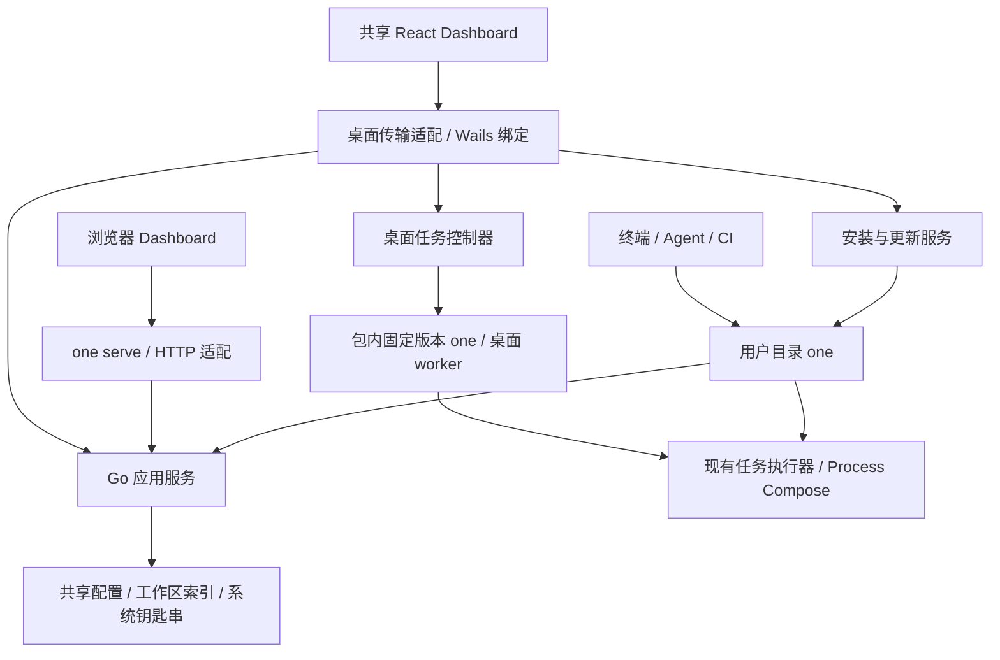

# One Desktop（Wails）完整方案

> 已被 [Tauri 2 + React + Go CLI 完整方案](2026-10-13-tauri-desktop-design.md) 取代。本文件保留历史讨论；其中 Wails、保留浏览器 Dashboard 和 `one serve` 的设计不再作为实施依据。

日期：2026-10-13（Asia/Shanghai）\
状态：待评审方案；没有实施、安装、构建、签名或发布。\
核查基线：`b0006701c8433b7081e08aaeaaa2eaca6e41181b`，编写前工作区干净。

## 1. 目标与范围

提供 One Desktop：用户安装桌面应用，首次初始化完成后，既能使用图形界面，也能在新开的终端中运行 `one`。保留现有脚本安装、CLI、SSH、Agent、CI 和 `one serve` 的使用方式。

桌面包包含可实际执行、可安装到用户目录的 One CLI。桌面和 CLI 使用同一版本、同一源码提交构建，复用现有 Go 业务层和 React Dashboard。终端中已有更高版本 CLI 时保留它，不为了匹配桌面版本而自动降级。

首版交付范围：

- 单实例、单窗口，窗口内切换多个工作区；目录选择和登记现有工作区。
- 复用现有工作区、项目配置、账号、共享凭据、环境变量管理页面。
- CLI 安装、PATH 引导、检查与修复入口。
- 桌面启动任务、查看状态和日志、停止整个任务调用；复用现有执行语义。
- 桌面版本检查、下载、更新安装、重启确认和失败恢复。
- macOS Intel/Apple Silicon、Windows x64、Linux amd64/arm64 为目标矩阵，按实机验证结果逐个平台开放；不能仅凭编译通过宣布支持。
- 所有新增用户界面、错误、菜单、更新说明同时支持 `zh-CN` 和 `en-US`。

首版不包含远程主机代理、独立后台守护进程、开机自启、完整交互式终端、云端同步和重做全部 Dashboard。保留现有 TUI，不在本项目中立即移除它。目录选择以外的原生集成按具体用户流程添加。

## 2. 已核实的现状

| 现有能力 | 证据 | 对方案的影响 |
| --- | --- | --- |
| React 19、Vite 8、Tailwind v4 Dashboard | `apps/dashboard/package.json` | 保留组件与前端技术栈；需验证系统 WebView |
| Dashboard 以 `/api` 调用本地 HTTP，使用 BrowserRouter | `apps/dashboard/src/lib/http.ts`、`src/main.tsx` | 增加桌面传输适配和路由入口 |
| Go 业务服务已有依赖组装，HTTP 注入业务服务 | `packages/cli/internal/bootstrap/cli/dependencies.go`、`internal/transport/http/server.go` | 可以共享服务，避免复制业务实现 |
| `one serve` 只监听 loopback，检查 Host/Origin | `packages/cli/internal/transport/http/middleware.go` | 浏览器边界保留；不为桌面而放宽校验 |
| 任务使用 Process Compose，叶子任务调用当前可执行文件的 `__process` | `internal/modules/tasks/service.go`、`compose.go` | 不能直接把 GUI 可执行文件当作 CLI worker |
| 任务内部已有带 token 的 loopback broker | `internal/modules/tasks/broker.go` | 不向前端暴露 broker token、命令环境或原始接口 |
| CLI 默认安装到用户目录 | `apps/docs/public/install.sh`、`install.ps1` | 桌面安装保持目录和版本规则一致 |
| Unix 安装器仅提示 PATH；Windows 会写用户 PATH | 同上 | “安装成功”和“终端可用”需要分开检查 |
| `one upgrade` 解析当前程序真实路径，并替换该文件 | `internal/platform/updatecheck/manual.go` | 必须阻止内置 CLI 修改桌面包 |
| 登录使用系统浏览器及临时本地回调，token 放系统钥匙串 | `internal/platform/infisicalsession/login.go`、`session.go` | 复用登录和会话，不把 token 交给 WebView |
| 工作区登记有跨进程锁，偏好采用原子文件写入 | `internal/adapters/workspaceregistry/local/store.go`、`internal/platform/preferences/preferences.go` | 共享存储仍需补齐并发写入与版本兼容审查 |
| 发布流程严格检查五个 CLI 归档加 `checksums.txt` | `scripts/release-rules.mts`、`RELEASING.md` | 需要版本化产物规则，同时认可历史六附件发布 |

以上来自当前仓库代码。后续章节中的目录、命令、接口、状态和发布附件若不在本表中，均为拟新增设计，不代表已有功能。

## 3. Wails 版本与技术选择

### 3.1 推荐基线

以 **Wails v2 稳定线**实施，技术验证候选固定为当前文档版本 `v2.15.0`；验证通过后将 CLI 工具与 Go 库锁定到同一精确版本。现有 Go、Node、pnpm、React、Vite、Tailwind 先保持版本不变。

官方当前将 v2 标为稳定线、v3 标为 Beta。v3 已提供多窗口、托盘和内置更新能力，值得后续评估；本方案选择 v2 是为了控制首版框架变量，并不是认为 v3 没有更新器。[版本状态](https://v3.wails.io/blog/wails-v3-beta/)、[v3 更新能力](https://v3.wails.io/faq/)

Wails 提供窗口、原生菜单、对话框和 Go/JS 调用能力。[官方介绍](https://wails.io/docs/introduction/)

### 3.2 接入方式比较

| 方案 | 收益 | 代价 | 结论 |
| --- | --- | --- | --- |
| Wails 绑定调用 Go 服务，内置 CLI 执行任务 | 业务复用、类型明确；任务仍走现有执行器 | 增加桌面适配层和任务事件接口 | 推荐 |
| Wails 托管 `one serve`，复用全部 HTTP | 最快展示当前 Dashboard | 常驻本地端口、进程就绪、认证及导航边界；仍需任务 API | 可作短期验证，不作为交付架构 |
| 所有操作均启动 CLI 子进程并解析输出 | 进程边界统一 | 频繁启动，账号/配置操作协议更绕，易依赖展示文案 | 不采用 |

不通过 Wails AssetServer 硬接现有全部 `/api`：官方列出了 WebSocket、流式响应等限制，并提示 Handler 与 Vite 5+ 开发服务器的兼容问题。当前仓库是 Vite 8，优先采用绑定接口，避免把这些差异传播到业务代码。[AssetServer 说明](https://wails.io/docs/reference/options/#assetserver)

### 3.3 平台边界

系统 WebView 和 CLI 的支持范围分别管理。Tailwind v4 要求较新的浏览器能力，因此不直接采用 Wails 文档给出的最低 OS 作为 One Desktop 的最低 OS。[Tailwind 浏览器要求](https://tailwindcss.com/docs/upgrade-guide#browser-requirements)

拟验证基线：macOS 13.3+、Windows 10/11 x64 加受支持的 WebView2、Ubuntu 24.04 LTS 桌面及选定 WebKitGTK 4.1 版本。这些是验证候选，不是已经确认的支持承诺。需要检查 CSS、中文输入、菜单、选择复制、日志渲染、缩放和深色模式；Linux 的 WebKitGTK 版本必须逐项记录。

macOS 构建需要原生工具链，Windows 运行需要 WebView2，Linux 需要 GTK/WebKit。最终用户不需要安装 Go、Node、pnpm 或 Wails；项目开发工具继续按 One 原有机制按需准备。[平台依赖](https://wails.io/docs/gettingstarted/installation/)

## 4. 总体架构

图中的“共享”表示同一套源码与持久化约定，不表示桌面和终端在同一个进程内。没有全局“当前工作区”；每次操作携带登记后的工作区 ID，由 Go 端解析、校验真实目录。

### 4.1 三个运行角色

| 角色 | 使用场景 | 更新所有者 |
| --- | --- | --- |
| One Desktop GUI | 人的主要管理入口 | 桌面更新器 |
| 包内 `one` | 桌面任务 worker、安装源、诊断 | 桌面更新器；独立自更新禁止 |
| 用户目录 `one` | 终端、SSH、Agent、CI | 现有 CLI 更新器；桌面可按规则升级它 |

桌面调用包内 CLI 时使用经过验证的绝对路径，绝不从 PATH 寻找自己的后端。用户修改或删除终端 CLI，不影响桌面启动。

### 4.2 同一 CLI 二进制与安装上下文

优先使用同一平台、同一 Release 的 CLI 产物：桌面内置程序与公开 CLI 归档中的程序保持一致，复制到用户目录后成为普通 CLI。

为此，新增安装上下文识别，区分 `desktop-bundled`、普通安装、开发启动器和外部管理安装。内置身份依据规范化后的可执行文件位置、应用布局和已验证的 bundle manifest；不能只依赖一个容易丢失的环境变量或 PATH。

内置 CLI 的后台更新、显式 `one upgrade`、更新 worker 均在实际替换前复核所有权并拒绝修改应用包。复制安装后的 CLI 按普通安装规则更新。开发构建继续保持现有不自更新规则。

如果技术验证证明同一产物无法可靠识别安装上下文，需另行评审双构建方案；不临时把“开发通道”当成正式内置发行通道。

### 4.3 前端复用

保留现有页面、SWR、Zustand、i18next 和组件。将 `apps/dashboard/src/api/*` 后面的能力抽象为带类型的客户端：浏览器实现使用 HTTP，桌面实现使用 Wails 绑定。

新增桌面能力接口：目录选择、初始化计划、CLI 安装、版本查询、更新进度、任务操作。避免暴露任意 shell、任意文件读写或通用 `Execute(command)` 给前端。

浏览器产物保持 BrowserRouter；桌面产物先使用 HashRouter，避免原生资源地址下刷新与深链接差异。两者使用同一份页面与业务组件，构建输出分开，不覆盖当前用于 `go:embed` 的浏览器产物。

长操作返回操作 ID，通过事件推送进度并提供查询快照；重新订阅后可以恢复界面。保留现有错误码、具体原因、恢复建议，中文英文只翻译展示层。

### 4.4 Go 目录与构建隔离

首版桌面入口放在现有 CLI Go module 内，建议 `packages/cli/cmd/one-desktop/`。这样可合法复用 `packages/cli/internal`，不需要为了桌面版大规模公开内部包，也不把 One 业务代码搬进通用 Kernel。

Wails 相关源文件使用专用 `one_desktop` build tag 隔离；CLI 的 `CGO_ENABLED=0` 构建和服务器静态检查仍可独立完成。桌面专用构建显式带该 tag，以及所选 Wails 版本要求的平台标签。标签名称和命令在首个技术验证阶段确认，不直接假定自动脚手架能适配 monorepo。

从 `bootstrap/cli/dependencies.go` 提取通用依赖组装，去掉 prompt、全局输出状态和必须依赖 TTY 的副作用；CLI、HTTP、桌面分别提供展示与进度回调。

### 4.5 WebView 与本机能力边界

发布版仅加载随包前端，禁止窗口导航到任意远程页面；登录和外部文档通过系统浏览器打开。开发服务器 origin 只在开发构建中启用，不扩大生产绑定的来源范围。

Wails 绑定逐项校验输入、工作区身份、路径和操作范围。原生目录选择返回的路径仍须经过工作区登记服务；更新、删除、变量写入等操作使用各自的类型化接口。任务日志与错误内容按不可信文本呈现，ANSI 仅用于允许的显示效果，不能借日志触发 HTML、脚本或本机操作。

浏览器 `one serve` 的 Host/Origin 保护保持原样。桌面不为配置管理额外开放网络端口，但现有登录回调和任务内部 broker 仍会临时使用受约束的 loopback 端口，不能宣称整个应用完全不监听端口。

## 5. 首次初始化

### 5.1 用户流程

桌面应用先打开可用的欢迎页面，再运行检测。初始化不依赖联网获取 CLI，也不要求登录。Windows 缺少 WebView2 等导致 GUI 尚不能运行的情况，由安装包前置检查和系统安装流程处理，不能指望 Wails 页面自行解决。

### 5.2 检测与预览

- 校验当前包的平台、架构、版本、源码 SHA、内置 CLI 摘要与 worker 协议版本。
- macOS 检测是否从只读安装介质或临时位置运行；提示安装到持久位置后完成设置。Windows 默认用户级安装；Linux 默认用户级版本目录。
- 检查默认 CLI 位置、已有安装记录、自定义安装位置及常见 shell 实际解析结果；列出冲突，不只执行一次 `which` 就判断成功。
- 区分普通文件、开发软链接/启动器、包管理器入口、无法识别文件。现有开发启动器一律保留；建议用户选择其他目录或显式接管。
- 展示精确版本变化、安装位置、将改动的 shell 配置文件或用户 PATH；点击“完成设置”即授权这些具体变更，不增加逐步重复确认。

安装目录默认与脚本一致，并支持用户明确指定目录。已有记录可信且有效时复用该目录；`ONE_INSTALL_DIR` 等现有脚本选项继续兼容，但 GUI 不假定能继承用户终端中的环境变量。

### 5.3 安装决策

| 检测结果 | 默认行为 | 初始化状态 |
| --- | --- | --- |
| 无 CLI | 从应用包复制安装 | 安装后验证 |
| 普通正式版低于内置版本 | 升级到内置版本 | 安装后验证 |
| 同版本且健康 | 保留；继续检查 PATH | 验证后可完成 |
| 高于内置版本 | 保留较新版本，显示桌面/终端两个版本 | 路径正确即可完成 |
| 版本可读但疑似损坏 | 不凭同版本号判断健康；提供明确修复动作 | 待修复或跳过 |
| 开发版、软链接、包管理器或未知文件 | 不自动覆盖，显示路径和接管选项 | 待处理；桌面仍可使用 |
| 文件被占用或写权限不足 | 保留旧文件，显示原因和重试 | CLI 安装待完成 |

版本相同但文件摘要与官方产物不同，不能直接视为损坏：可能是开发者重建。修复操作必须区分官方安装和自定义文件。

### 5.4 安装事务

安装与升级使用同一套事务：

1. 获取目标路径对应的安装锁，读取原文件状态和摘要。
2. 验证源程序与可信 manifest，写入目标目录内的临时文件。
3. 设置正确可执行权限，运行受控的版本/构建信息探测；明确禁止探测触发更新。
4. 再次确认目标未被其他安装器修改，原子替换并保留本次恢复需要的旧文件。
5. 验证新目标的版本与摘要，写入安装记录。
6. 若替换后验证失败，只在当前文件仍由本次操作写入时恢复旧文件；不能覆盖另一个更新器刚装的新版本。

CLI 更新器、桌面 CLI 安装器、改造后的脚本安装器共用这套规则和锁。旧版脚本/旧版 updater 不认识新锁，因此仍须保留摘要复核、平台原子替换和启动后重新验证；不宣称对所有历史安装器实现严格互斥。

安装记录只保存位置、版本、摘要、来源、所有权和时间；无凭据。重复初始化可重试，不能重复追加 PATH 或重置用户配置。

### 5.5 PATH 处理

| 平台/场景 | 建议处理 |
| --- | --- |
| macOS/Linux zsh、bash | 识别 shell 与实际配置位置，生成可移除、幂等的 One 管理块；在用户点击完成设置时写入。zsh 尊重 ZDOTDIR，bash 兼顾交互与登录入口 |
| fish 或非标准 shell | 首版给出准确的手动配置和复检入口，未验证前不标记终端就绪 |
| Windows | 沿用现有用户 PATH 规则，大小写与目录尾分隔符归一化去重，广播环境变化；不重写整条 PATH |
| 别名/函数/更靠前的其他 `one` | 显示真正命中的入口，提示处理；不删除用户自定义别名和函数 |
| 已打开的终端/IDE | 提示新开终端或重启宿主；不声称能替换已有进程继承的环境 |

Unix 验证在受控的新交互/登录 shell 中检查解析位置和版本；shell 启动配置属于用户代码，允许取消并设超时，避免卡住引导。无可靠探测结果时显示“CLI 已安装，终端配置待确认”。不把 shell 的完整环境、token 或启动输出上传。

提供三个独立状态：`desktopReady`、`cliInstalled`、`shellReady`。只有目标 CLI 可用且选定 shell 的入口验证通过，才展示“初始化完成”；用户可跳过终端配置进入桌面，并在设置页继续完成。

### 5.6 与现有脚本的关系

将安装拆成两段：脚本负责平台识别、下载、SHA256 验证和引导；公共安装服务负责本地产物的版本决策、事务、PATH 计划和验证。桌面直接使用本地随包源。

拟新增一个面向安装器的内部安装入口，由下载并验证后的新 CLI 调用；它不是面向用户日常使用的新命令。该入口名称和 schema 在实现前锁定，失败使用现有结构化错误约定。

脚本保留现有环境变量。Unix 管道安装默认继续只提示 PATH，除非用户显式选择新选项；桌面通过初始化按钮授权 PATH 写入。两者的版本与文件结果一致，但保留各自的交互授权方式。下载旧发行版时走兼容旧逻辑，不要求历史 CLI 支持新入口。

### 5.7 本机初始化与业务就绪

首次初始化不自动创建项目、修改 manifest、登录账号或准备所有开发工具。mise、Process Compose、Node、Go 和项目依赖沿用按需准备，实际任务首次运行可能仍需联网。

初始化完成页可以显示“CLI 可用”“账号未登录”“项目工具将在首次使用时准备”，避免把安装成功解释为所有业务操作均可离线执行。

## 6. 数据、身份与环境一致性

复用现有偏好、工作区登记、共享凭据绑定和系统钥匙串，不复制一套桌面账号。新增桌面窗口状态、初始化记录和更新事务记录，放在 One 现有目录约定下的独立文件中。

| 数据 | 原则 |
| --- | --- |
| `preferences.json` | 继续复用 locale 与 taskUI；桌面窗口信息单独存储 |
| `workspaces.json` | 复用跨进程锁和登记服务 |
| manifest | 继续预览、revision 校验、原子写入 |
| 系统钥匙串 | 沿用 `one-cli.infisical` / `session`；验证签名桌面、内置 CLI、用户 CLI 的实际访问行为 |
| 安装记录 | 路径、摘要、来源、所有权；不作为放宽文件校验的依据 |
| 桌面更新状态 | 单独的缓存和锁，不与 CLI `update-check.json` 混用 |

GUI 从 Dock/启动菜单运行时，PATH 和 XDG 环境可能与终端不同。默认仍沿用现有 One 目录规则；如果用户曾在 shell 中定制 XDG，初始化必须展示实际解析目录并提供统一启动配置的引导。不得自动执行所有 shell 文件来“导入环境”，也不得把新目录中的空配置误当成账号丢失后直接重置旧数据。

首版共享持久化格式采用向后兼容扩展。特别审查偏好保存是否丢弃未知字段、账号切换后前端缓存是否失效、CLI 与桌面同时写入是否相互覆盖。应用降级或回滚时不得反向覆盖较新格式数据；不能兼容时阻止相关写操作并给出升级建议。

偏好等仍可能发生竞争的写入需改为跨进程加锁的读改写，并保留未知字段；桌面专有字段放在独立文件中，减少旧 CLI 写回时丢失数据的风险。共享格式发生不兼容变更时，最低可写版本必须进入更新兼容性元数据，不能仅靠 GUI/CLI 版本号相同推断兼容。

登录继续打开系统浏览器，沿用现有回调验证和超时。Wails UI 仅得到会话状态；需要用户主动查看/复制变量时才短暂取值，不把凭据放进 localStorage、操作日志或更新元数据。

## 7. 任务、日志与应用生命周期

### 7.1 执行路径

桌面任务控制器通过绝对路径启动包内 `one` 的专用 worker 入口，每个执行调用对应一个 worker。worker 复用现有任务规划、环境注入、Process Compose、`__process` 叶子任务和退出码语义。

当前 `defaultWorker` 使用 `os.Executable()`；如果直接从 Wails 进程运行任务，会得到 GUI 程序路径。独立 CLI worker 能保留正确入口，同时避免让 Wails 主进程的全局 signal、TTY、stdout 状态影响任务。

不解析 TUI 屏幕，也不从 `[task]` 日志前缀猜测任务状态。给现有执行器补充结构化观察接口；TUI 和桌面使用同一状态来源。

### 7.2 拟新增的内部协议

协议以 `one-cli/desktop-worker/v1` 标识，并在 GUI、bundle manifest、CLI 之间做握手验证。

- 请求：工作区 ID、任务选择、参数、环境选择、调用 ID；Go 端重新校验目录与任务。
- 事件：`ready`、`plan`、`task-state`、`log`、`result`、`error`，携带调用 ID、单调序号及必要的任务 ID。
- 日志：保留 stdout/stderr、ANSI、回车覆盖和原始字节顺序；协议采用安全编码，不能让原始子进程输出污染控制消息。
- 控制：启动、取消、状态快照和按序号读取日志；结束结果保持现有状态值及退出码。
- 不向 UI 发送环境值、broker token 或登录 token。脱敏诊断与原始任务日志分开；子进程本身打印的敏感内容不假装能完全识别。

建议父子进程通过专用标准输入/输出管道传输有帧结构的消息，worker 将任务原始输出封装为日志事件，诊断另走 stderr。命令参数数组调用，不拼接 shell 命令。IPC EOF 触发取消；Windows 加进程树生命周期约束，Unix 使用进程组与父进程退出检测。

### 7.3 日志与窗口行为

- 大日志采用有界内存缓冲、分批事件和虚拟列表，完整会话日志临时落盘并有容量上限、清理规则。
- 前端消费变慢不应阻塞任务退出；超出保留范围明确提示，并允许读取仍保留的日志片段。
- 最小化窗口继续任务。首版没有独立后台服务；真正退出时，有活动任务则提示“停止任务并退出”或“取消退出”。
- 手动启动的外部 CLI 任务不归桌面管理，桌面退出和更新不得停止它们。
- GUI 异常退出时其 worker 收到通道关闭并清理子进程；下次启动展示异常结束，不伪造成功，也不盲目根据旧 PID 杀进程。
- 需要完整交互式 TTY 的任务首版在外部终端运行；不把纯日志面板伪装成终端。

## 8. 更新与回滚

### 8.1 更新所有权

| 操作 | 行为 |
| --- | --- |
| 桌面检查更新 | 查找有兼容桌面产物的稳定 Release，展示版本与中英文说明 |
| 桌面更新 | 整体替换 GUI、内置 CLI 和包内资源 |
| 内置 CLI 后台检查或 `upgrade` | 禁止独立替换；提示由桌面管理 |
| 用户目录 `one upgrade` | 继续独立升级该 CLI，不升级桌面应用 |
| 桌面更新后同步用户 CLI | 若低于内置版本则升级；相同保留；更高保留；外部管理安装跳过 |

桌面、内置 CLI 必须版本和源码一致；用户 CLI 允许不同版本。关于页同时显示三者及安装位置，不使用一个版本标签掩盖差异。

### 8.2 桌面更新状态机

`idle → checking → available → downloading → verified → waiting-for-idle → applying → restarting → healthy`

失败状态包括 `download-failed`、`verification-failed`、`apply-failed`、`rollback-pending`、`rolled-back`。每一步持久化事务 ID、源/目标版本、路径和摘要，重新打开后可恢复。

检查可以后台限频进行；首版由用户点击“下载更新”“重启并更新”实施，不静默关闭窗口。网络失败或无新版本不阻挡应用启动。未联网仍可使用已安装功能。

### 8.3 完整流程

1. 获取稳定版本元数据，验证发布通道、平台、最低系统要求、协议和配置兼容范围。
2. 下载到独立临时目录，检查大小限制、SHA256、签名和归档路径安全；失败不动当前安装。
3. 准备同文件系统 staging 与旧版本恢复位置；记录事务，并获取应用更新锁。
4. 等待本桌面的任务和配置写入结束。用户选择停止任务时先正常取消、等待清理完成；不得为更新直接丢弃工作。
5. 启动更新 helper，验证父进程身份、目标真实路径、事务文件、旧文件摘要及待安装文件签名。
6. GUI 正常退出后执行平台更新，再启动新版本。
7. 新版本完成 Go 服务、内置 CLI 协议/版本检查和前端就绪握手后写入健康确认；仅“进程启动”不能算更新成功。
8. 确认健康后，按安装规则同步用户目录 CLI，并分别报告桌面更新与 CLI 同步结果。

桌面整体更新与终端 CLI 同步是两个事务。后者失败时新桌面仍然可用，设置页显示重试；不因为终端 CLI 被占用就反复回滚健康桌面。

### 8.4 平台安装与恢复

| 平台 | 初次分发 | 更新实施 |
| --- | --- | --- |
| macOS | 签名、公证后的 `.app` 放入 DMG | 下载包含完整 `.app` 的 ZIP；helper 在应用退出后替换整个 bundle，保留旧 bundle。不可直接改包内 `one` |
| Windows x64 | 用户级安装器，包含 WebView2 前置检测 | 已签名安装器/helper 等待进程退出后安装新版本；返回明确 pending/成功/失败。目标占用时等待或提示重试 |
| Linux amd64/arm64 | 用户级归档安装，写 `.desktop` 入口并声明 GTK/WebKit 依赖 | 下载到新版本目录，验证后切换受管理入口，保留前一版本。系统包管理器安装由包管理器负责 |

首版 Linux 不同时维护 deb/rpm/AppImage 全家桶；采用版本目录安装，支持范围限定在验证过的发行版/桌面环境。后续如加入系统包格式，必须显式声明更新所有者。

更新 helper 只处理既定应用路径和可信事务，不提供通用文件替换能力。macOS/Windows 所需签名、公证、凭据注入流程在发布阶段实现；缺少凭据时只能生成本地验证产物，不能宣称正式分发就绪。

新版本无法通过健康确认时，helper/启动恢复逻辑尝试恢复旧应用并展示原因。健康确认应使用有界超时并区分用户主动退出与崩溃。回滚只恢复应用文件，不删除用户工作区或回退远端变量；首版禁止不可逆配置迁移，以保证旧版可重新打开。

如果桌面已健康运行后才人工回退，终端 CLI 不随之自动降级。保留兼容性检查；明确不兼容时指导用户选择对应版本。

### 8.5 签名与更新元数据

发布拟新增 `desktop-release.json` 及其签名，包含：schemaVersion、version、sourceSHA、channel、平台产物、文件大小与摘要、最低 OS/WebView 要求、bundle CLI 摘要、worker 协议和配置兼容范围。

桌面内置更新验证公钥，校验元数据签名及产物摘要；同时执行平台代码签名检查。签名密钥通过现有凭据注入，不落入仓库、制品或日志。元数据只描述固定发布附件，禁止接受任意目标安装目录。公钥轮换和恢复版本策略在首次发布前写入发布手册。

Wails v2 的应用更新作为 One 的专用模块实施；不把 `wails update` 当作产品更新命令，它更新的是开发用 Wails CLI。[Wails CLI 文档](https://wails.io/docs/reference/cli/#update)

## 9. 打包与发布

### 9.1 两类公开产物

保留现有五个 CLI 归档名称及内部 `one`/`one.exe` 名称，`checksums.txt` 保持兼容现有安装器。桌面包额外发布，首次桌面 Release 与同版 CLI 使用同一个 tag 和固定 source SHA。

建议桌面附件名称（拟新增）：

| 文件 | 用途 |
| --- | --- |
| `one-desktop_darwin_amd64.dmg`、`one-desktop_darwin_arm64.dmg` | macOS 首次安装 |
| `one-desktop_darwin_amd64.zip`、`one-desktop_darwin_arm64.zip` | macOS 完整 bundle 更新 |
| `one-desktop_windows_amd64_setup.exe` | Windows 安装与更新 |
| `one-desktop_linux_amd64.tar.gz`、`one-desktop_linux_arm64.tar.gz` | Linux 用户级版本目录安装与更新 |
| `desktop-release.json`、`desktop-release.json.sig` | 桌面产物与兼容性元数据 |

目标矩阵是计划，不要求未通过实机验证的平台提前公开。每次版本规划时固定本次支持矩阵与精确附件列表；已纳入版本计划的平台缺件时不能临时静默忽略。尚未支持的平台在下载页明确标注。

桌面元数据覆盖桌面文件摘要以及包内 CLI 的来源和摘要；现有 `checksums.txt` 继续保留五个 CLI 归档条目，避免改变旧消费方的格式假设。签名和最终压缩完成后计算摘要，不对已签名制品再进行会改变内容的加工。

### 9.2 沿用发布主入口

统一入口仍为 `mise run release`，GoReleaser 仍固定 `2.18.0`。CLI 继续使用现有 CGO 关闭的构建配置；桌面采用独立平台构建任务，不把 GUI 依赖灌入 CLI 构建。

Wails 桌面构建需要对应平台工具链，不能继续假定一台主机按现有 CLI 方式交叉编译所有 GUI 产物。[跨平台构建说明](https://wails.io/docs/guides/crossplatform-build/)

发布编排扩展为：

1. 固定 master 源码 SHA、版本、平台矩阵及产物 schema。
2. 使用该 SHA 的独立干净副本，完成 `mise run check` 和前端/CLI 构建。
3. 构建并验证 CLI 产物；桌面各平台构建复用该版本的准确 CLI 载荷，防止每个平台自行解析 latest。
4. 平台构建任务只返回制品和包含 SHA、版本、工具链、摘要的构建记录，不自行创建 tag 或公开 Release。
5. 收集 GUI 制品、完成签名/公证和平台冒烟验证，生成最终桌面元数据及签名。
6. 全部本地验证通过后推送固定 tag、创建草稿、上传计划中的全部附件。
7. 下载草稿附件逐个核对摘要、签名和内置版本；通过后才公开并设为 Latest。

平台构建可在配置好的原生构建主机或受控 CI runner 上执行；本方案不创建这些资源，也不假定当前已具备 Windows/Linux 桌面构建与签名条件。总入口和发布决定保持唯一。[代码签名说明](https://wails.io/docs/guides/signing/)

### 9.3 历史与续发兼容

`release-rules.mts` 需要区分历史 CLI-only schema 与新增 desktop schema。历史版本仍严格按六附件规则判断完整；新增版本按已固定、受验证的 manifest 和平台矩阵判断完整，不能简单将附件检查改成“有 CLI 就算成功”。

本地 `release.json` 构建记录显式保存 schema 与 expectedAssets；读取旧记录兼容旧 schema。历史已公开 Release 不追加、替换附件，不移动 tag。中断后继续原 tag 和原提交；需要修改缺陷时发布新版本。

桌面更新器只选择包含兼容桌面元数据的稳定版本。旧 CLI 更新器继续按原 CLI 文件名获取新版 CLI；公开桌面包不能破坏现有脚本和 `one upgrade`。

## 10. 卸载与修复

- 默认卸载桌面仅删除应用及桌面快捷入口；用户目录 CLI 保留，继续用于终端。
- 配置、项目、共享凭据、系统钥匙串会话不随应用卸载自动删除。用户通过现有登出流程清除会话。
- 可提供独立的“同时卸载由本应用安装的 CLI”选项；必须核对当前路径、来源、摘要，避免删除后来由用户升级或其他安装器接管的程序。
- PATH 管理块只有完全属于 One 且不再被保留的 CLI 使用时才移除；不删除整份 shell 配置，不回写过期的完整 PATH。
- 设置页提供“检查 CLI”“修复终端入口”“重试更新”“打开日志目录”。修复动作继续走计划、版本校验与事务规则。

## 11. 拟修改的代码范围

以下是实现阶段的改动地图，本轮均不实施。

| 路径 | 计划 |
| --- | --- |
| `packages/cli/cmd/one-desktop/`（新增） | Wails 入口、版本注入、生命周期 |
| `packages/cli/internal/bootstrap/app/`（新增） | 可复用依赖组装，CLI/桌面各自提供展示回调 |
| `packages/cli/internal/bootstrap/cli/dependencies.go` | 接入公共组装，保持现有命令依赖 |
| `packages/cli/internal/transport/desktop/`（新增） | Wails 绑定、类型化 DTO、错误转换、原生操作 |
| `packages/cli/internal/application/desktop/`（新增） | 初始化与桌面任务控制、操作快照 |
| `packages/cli/internal/platform/installation/`（新增） | 安装计划、上下文、锁、文件替换、PATH、验收 |
| `packages/cli/internal/platform/desktopupdate/`（新增） | 元数据验证、状态机、helper、恢复 |
| `packages/cli/internal/platform/updatecheck/` | 公共安装事务、内置所有权保护；保留普通 CLI 更新行为 |
| `packages/cli/internal/modules/tasks/` | 结构化观察接口和日志事件，不更换调度器 |
| `packages/cli/internal/transport/cobra/` | 内部安装入口及桌面 worker 入口，受控协议 |
| `apps/dashboard/src/api/`、`src/lib/` | HTTP/Wails 客户端适配，保持页面调用语义 |
| `apps/dashboard/src/main.tsx`、`vite.config.ts` | 浏览器/桌面入口、路由及分离产物 |
| `apps/dashboard/src/features/desktop-setup/`、`desktop-update/`、`task-runs/`（新增） | 初始化、更新和任务日志界面 |
| 前后端 `locales/zh-CN.json`、`en-US.json` | 同步文案，复用已有语言偏好 |
| `packages/cli/desktop/`（新增） | Wails 配置、平台打包资源与构建输入，不另建业务核心 |
| `scripts/desktop-build.mts`、`desktop-package.mts`（拟新增） | 适配 monorepo、生成绑定、原生构建、制品核查 |
| `mise.toml`、`packages/cli/Taskfile.yml` | 桌面显式任务；普通 CLI 检查不依赖图形工具链 |
| `scripts/release.mts`、`release-rules.mts`、现有发布规则检查 | 版本化产物集合、平台记录、签名、草稿验证 |
| `.goreleaser.yaml`、`RELEASING.md` | 保留 CLI 协议，补桌面发布规则与恢复流程 |
| `apps/docs/public/install.sh`、`install.ps1` | 使用新安装逻辑并保留旧发行版兼容 |
| `apps/docs/content/docs/zh/`、`en/` | 安装、初始化、更新、版本差异、卸载说明 |

目录布局最终由技术验证确认。首版不为展示一个“desktop 项目”而在 manifest 中重复登记同一个 CLI 根目录，也不引入第二份 Go 业务 module。桌面任务先归现有 CLI 项目管理；需要独立项目时另行处理 module 与 internal 边界。

## 12. 分阶段实施与验收

### 阶段 A：技术验证

验证固定 Wails v2 与当前 Go/Vite/React 的组合、monorepo 构建、生成绑定、System WebView、中文输入与复制、系统钥匙串、包内 CLI 定位和版本识别。

同时验证浏览器 Dashboard 仍可独立构建、CLI `CGO_ENABLED=0` 无 GUI 依赖。若出现必须降级现有前端或大规模改变构建的阻碍，回到版本选型评审，不静默升级 Wails v3 或切换框架。

完成标志：选定平台的实际窗口可以调用一个真实 Go 服务，独立 CLI 仍可运行；形成依赖和兼容性记录。此阶段不发布。

### 阶段 B：安装与首次初始化

先落地安装公共逻辑、所有权识别、用户目录 CLI、PATH、引导状态与修复，再扩展桌面页面。用临时 HOME/XDG 和隔离用户环境验证，避免修改开发者现有 `one` 启动器。

完成标志：未安装、旧版、同版、新版、开发启动器、PATH 遮挡、权限失败、重复初始化均能按本方案处理；关闭桌面后用户目录 CLI 仍可用。

### 阶段 C：管理能力与任务

迁移现有 Dashboard API 到双传输适配，复用账号与配置；接入 worker、状态事件、日志、取消和关闭窗口流程。

完成标志：同一工作区从 CLI/桌面得到一致的任务计划、环境选择与退出结果；账号切换、manifest 冲突校验、进程清理及两种语言均可验证。

### 阶段 D：更新与恢复

落地桌面元数据、签名验证、平台 helper、健康确认、回滚，以及更新后同步用户 CLI。通过本地受控升级包验证故障恢复，不用修改公开 Release 来制造测试。

完成标志：正常升级、下载中断、摘要/签名错误、程序占用、任务运行、断电/进程退出后重开、健康失败恢复、较新用户 CLI 保留均有明确结果。

### 阶段 E：发布集成

扩展 `mise run release`、schema、构建记录和草稿回读校验，补齐中英文安装及发布文档。先验证一个平台完整闭环，再按固定版本计划扩展其余平台。

完成标志：旧六附件 Release 仍正确识别，新产物全部可验证；旧安装脚本和旧 CLI 升级路径正常。各平台真机验收、签名条件和下载页支持声明一致后，才具备正式发布条件。

### 关键验收矩阵

| 类别 | 必须覆盖 |
| --- | --- |
| 安装 | 全新用户、现有正式版、较新 CLI、自定义目录、开发软链接、损坏文件、权限不足、磁盘空间不足 |
| PATH | zsh/bash、Windows 新终端、重复配置、别名/函数遮挡、自定义 ZDOTDIR、已打开 IDE |
| 兼容 | 系统 WebView CSS、IME、剪贴板、缩放、暗色、多语言；浏览器 `one serve` 无回归 |
| 身份 | 已登录、未登录、过期、钥匙串拒绝、CLI/桌面互相登出、账号切换缓存清理 |
| 任务 | 依赖失败、取消、原始 ANSI、回车进度、海量日志、worker 崩溃、GUI 异常退出、外部 CLI 不受影响 |
| 更新 | 包内自更新拒绝、用户 CLI 独立升级、并发安装、坏包、签名失败、无桌面产物版本、旧 schema、回滚 |
| 卸载 | 桌面移除后 CLI 保留、数据保留、已被接管的 CLI 不误删、PATH 修改不损坏用户配置 |
| 发布 | 同版本同 SHA、技能源 SHA、发布通道、各平台制品摘要、草稿下载验证、续发原 tag/原提交 |

沿用仓库现有质量门禁，实施后运行 `mise run check`、相关平台构建及制品冒烟验证；更新已有发布规则检查。重点用真实故障和端到端安装状态验证，不堆积只镜像实现的测试代码。本轮仅文档，无运行构建或环境修改。

## 13. 决策记录（均为 Proposed）

| ADR | 背景 | 建议决策 | 代价与替代方案 |
| --- | --- | --- | --- |
| D01 Wails 版本 | 保持 Go/React，首版需要完整初始化和更新 | 固定 v2 稳定线；v3 待独立评估 | v2 更新模块需自建；v3 虽有内置更新器但仍是 Beta |
| D02 业务连接 | 现有 Dashboard 是 HTTP，任务有 CLI 特有状态 | 管理操作用绑定，任务用内置 CLI worker | 新增适配与协议；比全部 subprocess 或常驻 serve 更清楚 |
| D03 两份 CLI | 桌面可靠性与终端独立使用都需要保障 | 包内固定版本、用户目录独立副本 | 占用重复磁盘空间；避免 app 链接因移动/卸载失效 |
| D04 初始化 | 已有脚本规则，但 Unix PATH 只提示 | 共用安装规则，桌面提供授权后的 PATH 设置 | 需要 shell 适配；不把复制成功等同终端就绪 |
| D05 更新 | GUI、内置 CLI、用户 CLI 生命周期不同 | 应用整体更新，健康后再同步用户 CLI | 不是全局单事务；能明确报告部分成功并重试 |
| D06 发布 | 既有附件名单是协议，不能破坏历史续发 | 版本化 schema，同 tag/SHA，唯一发布入口 | 需扩展严格检查和原生构建收集 |
| D07 进程生命周期 | 首版尚无守护进程 | 桌面退出清理本应用任务，外部 CLI 独立 | 关闭即后台运行需以后单独设计 |
| D08 数据 | 桌面和不同版本 CLI 会并存 | 共享现有目录和账号，新增数据兼容扩展 | 必须处理并发写与 GUI/终端环境差异 |

## 14. 评审结论与实施前待验证项

本方案建议接受的方向：Wails 桌面应用、实际内置 CLI、首次设置安装用户 CLI、复用现有业务与数据、桌面整体更新和终端 CLI 独立更新、同一发布入口管理两类产物。

无需在本轮确定负责人、工期或发布日期。以下是实施阶段的真实验证门槛：

1. 固定 Wails v2 与当前 Go 1.27 / Vite 8 工具链是否兼容，以及每个平台的最低 WebView 能力。
2. 经过签名的桌面/CLI 是否可按预期共享钥匙串会话，GUI 与 shell 自定义配置目录是否一致。
3. 原生构建主机、Windows/macOS 签名与公证凭据是否具备；当前未检查这些资源或凭据。
4. 平台 helper 对整包替换、占用处理、健康确认和恢复的真实行为。
5. 首次对外开放的平台矩阵；建议优先打通 macOS Apple Silicon 完整闭环，再按同一验收标准扩展。

这些未知项不以模拟成功替代。进入代码实现前以本方案评审结果为边界，技术验证发现偏离时更新决策记录。

## 15. 来源与阅读入口

仓库来源：

- [安装脚本（Unix）](../../apps/docs/public/install.sh) 与 [安装脚本（Windows）](../../apps/docs/public/install.ps1)
- [CLI 升级实现](../../packages/cli/internal/platform/updatecheck/manual.go)
- [Go 服务组装](../../packages/cli/internal/bootstrap/cli/dependencies.go)
- [任务执行与进程控制](../../packages/cli/internal/modules/tasks/service.go)
- [Dashboard 客户端](../../apps/dashboard/src/lib/http.ts)
- [发布规则](../../scripts/release-rules.mts) 与 [发布手册](../../RELEASING.md)

外部来源均为本轮查询到的官方资料，版本状态可能随时间变化；开始实施时重新核对版本，不自动采用 latest：

- [Wails 介绍](https://wails.io/docs/introduction/)
- [Wails v2 选项与 AssetServer 限制](https://wails.io/docs/reference/options/)
- [Wails v2 手动构建](https://wails.io/docs/guides/manual-builds/)
- [Wails 平台依赖](https://wails.io/docs/gettingstarted/installation/)
- [Wails 跨平台构建](https://wails.io/docs/guides/crossplatform-build/)
- [Wails 签名指南](https://wails.io/docs/guides/signing/)
- [Wails v3 Beta 状态](https://v3.wails.io/status/) 与 [更新教程](https://v3.wails.io/tutorials/04-self-update-a-wails-app/)
- [Tailwind v4 浏览器要求](https://tailwindcss.com/docs/upgrade-guide#browser-requirements)
